# 基于 Schema 的 Kernel 表示与生成

> TRE AI系统工程
> 汇报人：邵瀚雍（指导人：岩泉｜北园）

---

## 一、背景与立意：为什么要做自动化算子生成？

高性能算子（Kernel）是连接上层深度学习算法与底层异构硬件架构的核心枢纽。今天切入“自动化算子生成”这一命题，并非单纯追求一个局部的代码生成工具，而是同时锚定了**面向未来的 AI 自进化范式探索**与**面向当下的 MaaS 大规模推理产业刚需**。

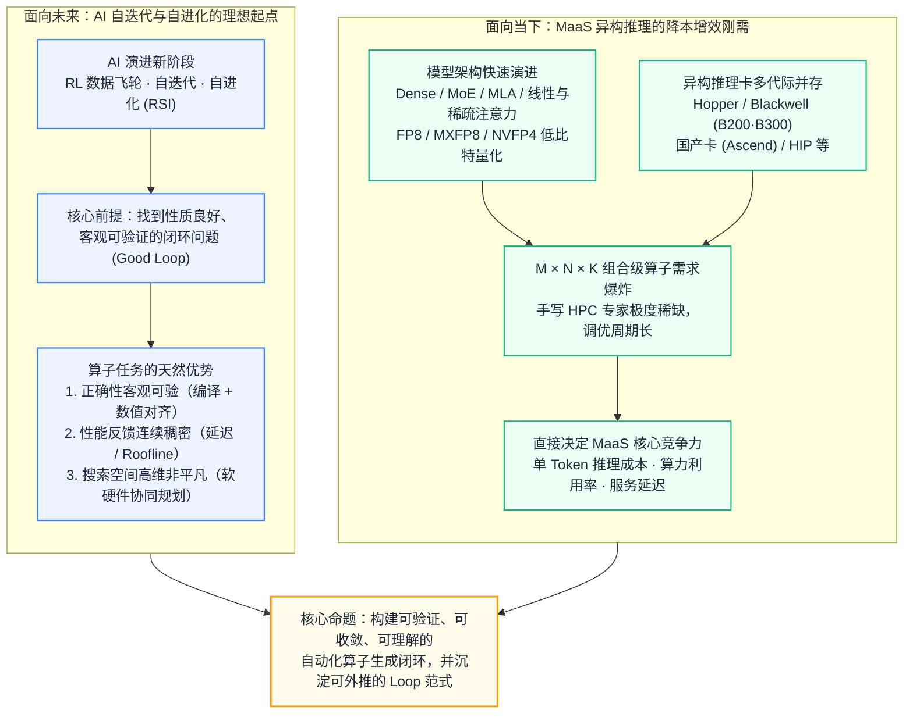

### 1.1 面向未来：构筑“性质良好、可被验证”的自动化闭环起点

从 AI 发展的宏观脉络来看，随着静态预训练语料红利见顶，模型能力的持续跃迁愈发依赖强化学习（RL）合成数据、长程工具交互（Agentic Harness）以及系统的自迭代与自进化（Self-Iteration / Recursive Self-Improvement）。而这一切自动化飞轮能够真正转起来的首要前提，在于**找到并建立一个性质良好、边界清晰且客观可验证的好问题（Good Problem & Verifiable Loop）**。

在众多复杂工程与科研任务中，高性能算子开发是少有的、几乎完美契合自进化闭环要求的典型载体：

1. **验证闭环绝对客观、无主观噪声**：算子能否通过编译、在覆盖边界条件的输入下数值精度是否与参考实现（Reference）严格一致，给出的是确定性的真值判据；而在硬件上的实测执行延迟与相对硬件理论上限（Roofline）的利用率，又提供了连续、稠密且真实的物理世界反馈信号。
2. **问题空间足够深邃且非平凡**：写好一个算子绝非简单的语法翻译，而是在严格的寄存器、片上存储（SMEM/TMEM）与带宽资源约束下，协同规划**数学等价改写、并行任务切分、多级存储复用与异步指令流水掩盖**的高维非线性组合优化问题。
3. **方法论具备极强的外溢价值**：只要我们能在高性能算子这一极具挑战的软硬件协同问题上，打磨出一套真正高效、可收敛、可沉淀知识的自动化 Loop，这套关于“问题表示、分层搜索、门禁验证与经验蒸馏”的核心机制，未来便有潜力外推至更广泛的系统设计与自动化科研任务之中。

### 1.2 面向当下：破解 MaaS 服务异构算力与模型演进的现实瓶颈

从产业落地的现实视角来看，自动化算子生成本身就是一个需求极其迫切、直接关乎商业账单的核心工程问题。

在当前大规模 MaaS（Model-as-a-Service）推理服务场景下，底层算子研发正面临剧烈的**多维笛卡尔积爆炸**：

- **模型结构与精度格式快速分化**：从标准 MHA/GQA 到多头潜在注意力（MLA）、线性注意力（GDN / KDA）、稀疏注意力以及大规模融合专家（Fused MoE），叠加 BF16、FP8、MXFP8、NVFP4 等细粒度混合精度量化，算子形态持续裂变；
- **异构与跨代际推理硬件并存**：既要吃透最新架构（如 NVIDIA Blackwell B200/B300 引入的 `tcgen05`、TMEM、2-CTA 协作等全新硬件原语），又要面向多种异构国产推理卡与不同代际集群做深度适配；
- **在线负载（Workload）高度动态**：Prefill、Decode、MTP（多 Token 预测）等不同阶段以及长短不一的动态序列分布，对算子在不同 Shape 域下的吞吐与延迟提出了截然不同的要求。

底层核心算子的执行效率，直接决定了 MaaS 服务的**单 Token 推理成本、整机算力利用率以及线上首字/解码延迟（TTFT / TPOT）**。然而，兼具数学功底与底层微架构经验的人类 HPC 算子专家极其稀缺，单靠人力逐卡、逐算子手写调优往往以周甚至月为单位，远无法跟上模型与硬件排列组合的扩张速度。

因此，**向远看，自动化算子是探索 AI 自进化闭环的理想试验场；向近看，它是打通 MaaS 异构推理效率与成本瓶颈的必由之路。**

---

## 二、领域现状：自动化算子生成的热潮与共性瓶颈

正因兼具极高的学术探索价值与工业落地价值，近两年来学术界、头部大模型机构与芯片厂商密集投入“自动化算子生成（Kernel Agent）”方向，在数据集、评测基准、专用模型训练与多智能体搜索框架上涌现出大批代表性工作。

### 2.1 三大主流技术路线概览

纵观现有工作对“模型能力注入位置”与“搜索组织方式”的设计，可将其归纳为三条代表性演进路线：

| 技术路线                                      | 代表性工作                                                                                                                 | 核心范式与机制                                                                                    | 已验证优势                                                                                 | 暴露出的局限性                                                                              |
| :---------------------------------------- | :-------------------------------------------------------------------------------------------------------------------- | :----------------------------------------------------------------------------------------- | :------------------------------------------------------------------------------------ | :----------------------------------------------------------------------------------- |
| **路线一：训练内化型** *(LLM4Kernel / Agentic RL)* | **CUDA Agent** *(字节 Seed × 清华, 2026)*                                                                                 | 合成多样化算子训练题，在可编译、测试与 Profiling 的真实 CUDA 环境中开展多轮 Agentic RL，将排障与代码改写内化至模型权重                  | 模型端到端工具调用与单点代码优化能力显著增强，分档奖励与随机输入有效抑制投机                                                | 高度依赖昂贵的可执行训练环境与题目合成清洗；权重绑定特定硬件与语言分布，跨新架构泛化受限                                         |
| **路线二：推理期搜索与执行反馈闭环** *(Agent4Kernel)*     | **AlphaEvolve** *(DeepMind)* · **AVO** *(NVIDIA, 2026)* · **KDA** *(MIT HAN Lab, 2026)* · **AKA** *(内部 Atrex-Kernel-Agent)* | 在冻结强基座模型之上，结合进化搜索/候选池演化、硬件知识库（Wiki）、Profiler 指标反馈（如 NCU）、独立校验与真实负载 Roofline 加权驱动长程迭代       | 在诸多单算子任务上取得显著提速；如 AVO 在 B200 上基于强先验持续演化 7 天可逼近/局部超越手写库，KDA 证明注入 Wiki 与 NCU 反馈可大幅提升加速比 | 直接在庞大底层代码空间做变异搜索，试错周期极长、Token 与 GPU 预算消耗巨大；收敛轨迹随机性强，生成代码易黑盒化与分支膨胀                    |
| **路线三：高层意图/调度中间层初探** *(Sketch / IR 分层)*   | **K-Search** *(UC Berkeley, 2026)* · **AKG Kernel Agent** *(华为)* · **CAKE** *(NVIDIA × CMU, 2026)*                        | 尝试将高层策略与底层代码分离：K-Search 维护自然语言优化意图树；AKG 生成跨 DSL 的 Unified Sketch；CAKE 定义编译器级调度 IR 并确定性生成代码 | 降低了单次编译失败对高层优化意图的破坏，初步验证了“策略与实现分离”的合理性                                                | 自然语言意图与粗粒度 Sketch 缺乏对片上资源、同步与数学改写的精确约束；而 CAKE 类编译器 IR 又强绑定特定算子域与专用后端，缺乏跨语言通用性与灵活留白能力 |

### 2.2 繁荣背后的同一性困境

上述工作充分证明了 LLM 与 Agent 闭环在算子自动生成与提速上的可行性。但当我们把视角从“中小规模标准算子刷榜”拉回到**复杂前沿生产算子（如 Blackwell 架构下的 FA4、Fused MoE、MLA、GDN 等）的真实研发与上线全流程**时，会发现现有 Kernel Agent 无论采用何种外围搜索技巧，都普遍撞上了同一堵天花板。

究其根本，现有主流方案大多仍在**直接以未压缩的底层实现代码作为知识载体、搜索空间与交付产物**。沿着算子生成任务的完整生命周期向深处剖析，这一范式在**事前（数据与表示）、事中（生成与迭代）、事后（结果与维护）**三个阶段暴露出了环环相扣的三大共性挑战。

---

## 三、核心挑战：贯穿算子生成全周期的三大根本性症结

直面并厘清当前自动化算子生成背后的本质矛盾，是我们确立技术路线与架构设计的真正起点。按任务推进的时间轴拆解，三大核心挑战分别对应着**能力上限问题、收敛效率问题与生产可用性问题**。

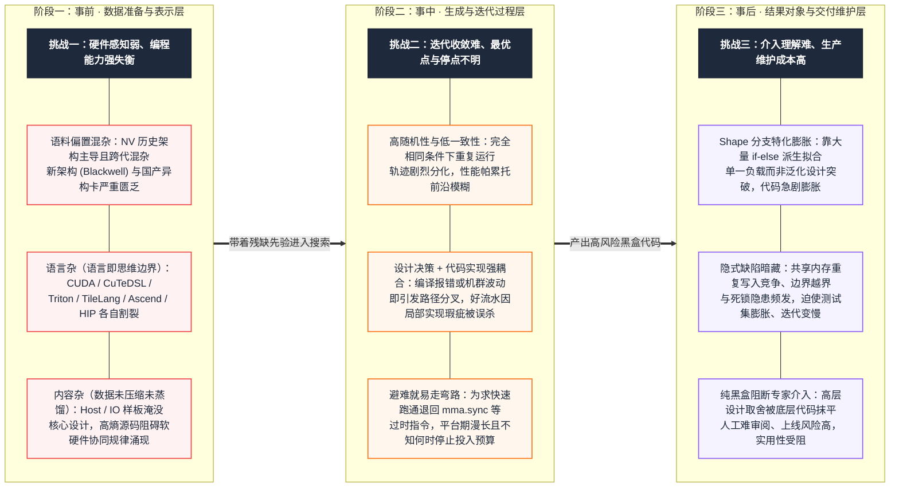

---

### 3.1 【事前 · 数据与表示层】“重编程、轻硬件”的能力失衡，源于多语言割裂与未压缩的语料困境

在算子生成任务尚未开始之前的数据准备与模型认知层面，当前基座模型与编码 Agent 呈现出鲜明的能力失衡：**通用编程与语法改写能力很强，但底层硬件物理感知与软硬件协同设计（Algorithm-Hardware Co-design）能力极弱。**

Agent 往往能够熟练写出语法合法的核函数，却并不真正理解目标硬件的计算吞吐、存储带宽层级、延迟掩盖机理以及为什么要针对该硬件采用特定的并行切分与流水结构。造成这种“轻硬件、重编程”现象的根源，在于现有算子语料与表达方式存在三重结构性缺陷：

1. **硬件语料偏置与跨代混杂，异构与新架构适应性差**

   现有预训练语料高度集中在 NVIDIA 特定历史架构（如 Ampere、Hopper）的代码片段上，且不同硬件代际的实现混杂在一起、缺乏显式的硬件能力边界标注。当面对全新微架构（如 Blackwell 的 TMEM 与异步指令体系）或国产推理卡（如昇腾 Ascend）、AMD HIP 等异构平台时，模型缺乏干净可靠的目标卡先验，往往无视目标硬件的真实物理特性而机械套用旧卡模板——这一问题在国产模型与跨架构迁移场景中尤为突出。
2. **语言生态碎片化——“语言是思维的边界”**

   当前算子开发语言极度繁杂，涵盖 `CUDA C++`、`PTX`、`CuTe / CuTeDSL`、`Triton`、`TileLang`、`Ascend C`、`HIP` 等不同抽象层级的编程栈。**语言是思维的边界**：当 Agent 直接绑定在某一种围绕特定硬件抽象设计的具象编程语言中思考时，其算子设计空间便被天然框死在该语言惯用的语法范式之内，难以站在第一性原理高度审视跨语言的共性数学改写与物理调度本质；尤其当面对 **Megakernel** 这类打破传统单算子边界、需要重新界定任务切分与融合范围的复杂场景时，受限于具体实现语言的表达颗粒度，Agent 更是难以把握全局设计边界。
3. **工程样板淹没核心设计——背离“压缩即智能”的数据本质**

   更深层的问题在于，现有算子源码（无论是用于模型训练的语料，还是推理阶段供 Agent 检索查阅的参考实现 Wiki）在信息密度上都是严重**未整理、未压缩、未蒸馏**的。一份数千行的工业级算子代码中（例如 FlashAttention-4 前向核心 CUDA 代码超过 2300 行），绝大多数篇幅都被 Host 端胶水逻辑、输入输出张量 IO 校验、指针步长计算、模板元编程与语法样板所占据，而**真正决定算子性能上限的核心设计决策（数学等价改写、工作块映射、片上缓冲复用与异步流水编排）反而只占百余行信息量，深深隐藏在冗长代码内部**。  
     **压缩即智能**——海量数据背后存在共性的结构规律，大语言模型涌现智能的本质正是对数据底层模式的高效压缩。当输入给模型的训练语料与参考 Wiki 充斥着大量与核心设计无关的工程噪音时，这种“语言杂 + 内容杂”的未压缩状态直接阻碍了模型对软硬件协同规律的提炼，从源头上锁死了算子自动设计的思维上限。

---

### 3.2 【事中 · 生成与迭代层】收敛随机且终点不明，源于“设计决策与代码实现强耦合”引发的路径坍缩

进入算子生成与长程优化迭代阶段后，第二个核心痛点随之浮现：**迭代过程一致性差、极易陷入性能平台期，且无法感知成本-收益的帕累托前沿（Pareto Frontier）与合理的收敛终点。**

在真实工程环境中，算子优化的每一轮尝试都伴随着实实在在的**墙钟时间、GPU 集群机时与海量 Token 成本**。然而在现有端到端代码迭代 Loop 中，我们既难以稳定复现最优路径，也回答不了一个关键的收敛判定与上限预测问题：**在给定预算取舍下，当前解距离“该算子在目标硬件上的真实可逼近极限”究竟还有多远？我们应当在什么时候停下来？**

这一困境在我们的多组实验中表现得极为显著：

- **相同条件下的强随机性与轨迹分化**：在 B300 环境对同一算子任务设定完全一致的初始条件与配置重复运行 AKA Loop，不同运行实例之间依然呈现出显著的收敛分歧——在前 10 个 episode 内，同配置重复运行的最慢与最快最终接受延迟相差达 **1.44×～1.67×**，同时单轮探索累计消耗数亿级输入 Token（含缓存）。
- **漫长平台期与未知的停止边界**：在 `013 GQA` 优化任务中，Opus 模型在第 `97` 个版本达到 `13.34 µs`，而 Qwen 模型在经历漫长的平台期停滞后，直至第 `1224` 个版本才观测到最佳点 `13.83 µs`（跑至 `v1367` 仍停留在 `13.91 µs`）。面对长平台期，系统无法判断究竟是已经触及硬件物理上限，还是困在了某个局部次优设计盆地中。

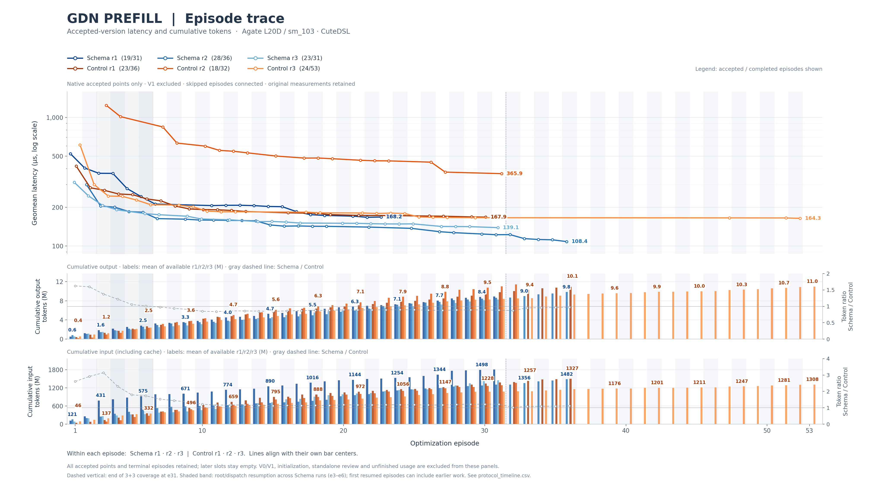

> *图：L20D（SM103）上* `GDN Prefill` *多路独立重复运行的收敛轨迹实证。重点观察橙色基线组（*`Control r1–r3`*）：在完全相同的初始条件与无外部参考设定下，不同 Run 的演化路径剧烈分化，其中* `Control r2` *长期滞留在* `365.9 µs` *附近的次优平台难以突破，与同组其他路径拉开数倍差距（蓝色曲线为后文第五章引入 Kernel Schema 设计引导后的收敛对照）。*

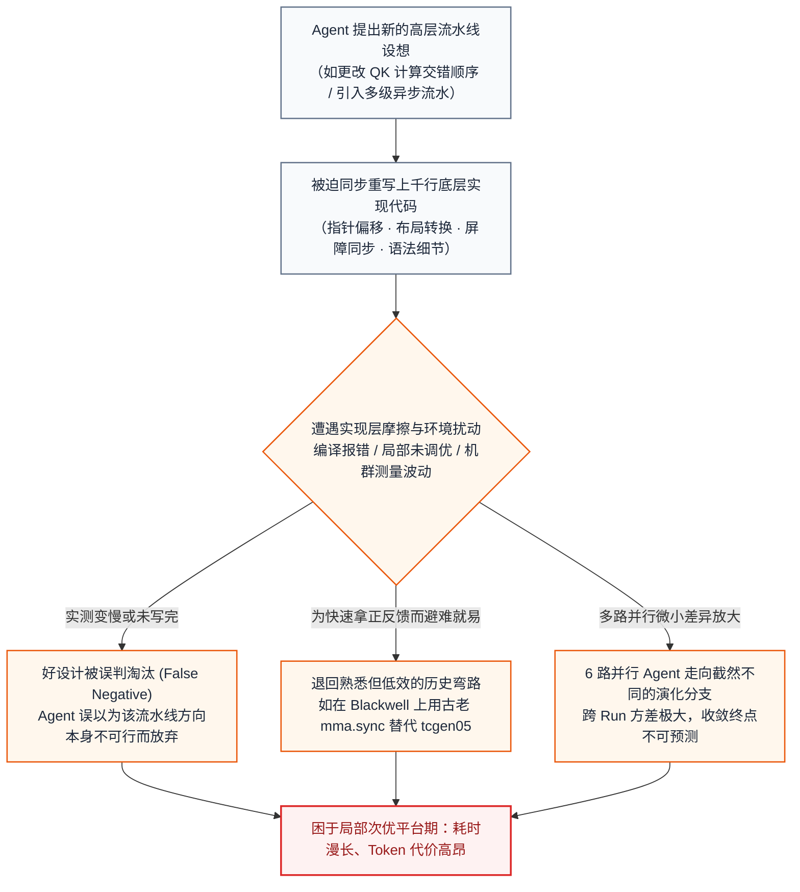

通过对多路并行 Agent（例如让 6 个 Opus Agent 并行迭代同一个明确算子任务）完整思维链（CoT）与演化轨迹的深度追踪，我们定位到了造成这种高随机性与难收敛的**核心机理——“高层设计决策”与“底层代码实现”的致命耦合**：

1. **微小工程扰动放大为全局路径分叉**：哪怕多个并行 Agent 从完全相同的起点出发，只要中途偶遇一次细微的编译报错、寄存器溢出或机群评测负载波动，微小的反馈差异就会诱发后续推理链路的蝴蝶效应，使不同 Agent 彻底走上截然不同的技术路线。
2. **正确的流水线设计因代码实现瑕疵被“误杀”（False Negative）**：在耦合模式下，每当 Agent 试图尝试一项结构性的新设计（例如调整注意力中 QK 与 PV 的计算顺序，或重构多级异步流水排布），都不得不推倒重写成百上千行底层代码。一旦在庞大的代码实现中混入局部索引瑕疵、未对齐的布局细节或尚未调优的参数，端到端实测表现便会下降甚至超时——此时 Agent 接收到的负反馈将“实现没写好”与“设计本身差”混为一谈，导致它**轻易放弃了一条在物理上完全正确且极具潜力的流水线设计**（我们在早期 FA4 多轮测试中便直接观察到，包含 `tcgen05` 与新流水结构的正确提案因单轮未写对而被门禁直接淘汰）。
3. **为求快速跑通而退回低效弯路**：由于底层重写摩擦极大，Agent 在初期为了尽快跨过编译与正确性门槛，极易产生短视倾向——例如在全新的 **Blackwell** 架构上，为了快速拼出能跑的代码，直接绕开原生高吞吐的 `tcgen05.mma` + TMEM 异步方案，退回自己语料最熟悉的古老 `mma.sync` 路线并在其上反复局部修补，从而在毫无潜力的错误分支上白白耗费大量搜索预算与时间。

---

### 3.3 【事后 · 结果与维护层】分支特化膨胀与隐式缺陷暗藏，黑盒产物阻断专家介入与生产落地

当迭代结束、审视 Agent 最终交付的算子代码结果时，第三个关乎能否真正走向生产的严峻挑战暴露无遗：**大量针对特定输入的分支特化与派生使代码急剧膨胀为黑盒，内部暗藏隐式并发与边界错误，导致人类专家极难理解介入、长期维护成本高昂。**

这一问题在我们的仓库实证审计中得到了直接印证。基于我们构建的 **44 个算子主库（包含 20 个 AKA 优胜解与 24 个参考实现）**，仅在对**首批 18 个算子（共 48 份完整设计）**开展深度静态提取与独立正确性复审的过程中，我们就系统性地揭示了端到端生成算子的三重落地隐患：

1. **依赖 Shape 分支特化派生“刷分”，代码急剧膨胀且缺乏泛化突破**

   面对多样化的评测负载，Agent 极度倾向于通过堆砌 `if-else` 分支与特定 Shape 的派生核函数来弥补单一核心设计在泛化性能上的不足（例如在提取复盘中，单个 `fmha_mxfp8_qkv` 算子曾拆解出数十个计划分支节点，仅 D128 split 单族就演化出“扫描×搬运×写回×归并”共 24 种组合；`nvfp4_fused_moe` 初始更是出现了 50 种 FC1×FC2 命名配对）。最终交付的代码动辄膨胀至数千行，人类工程师很难分辨其性能提升究竟源于**可泛化的流水线架构创新**，还是仅仅**对评测集中几个固定 Shape 的过拟合特化**。
2. **隐式并发竞争与边界缺陷漏网，陷入“测试集越堆越慢”的恶性循环**

   更危险的是，能够跑通有限评测用例的代码，内部依然潜伏着极难察觉的隐式错误。在首批 18 个算子的审查中，我们明确捕获了多类深层隐患：
   - **共享内存同址重复写入竞争（Race Condition）与逻辑越界**：在 `fmha_mxfp8_qkv` 的多个空 split 分支实现中，零有效块路径仍会准备 Query 并写入零部分和，但源码在复用共享缓冲写入前缺失了必要的跨 warp 同步汇合（后置 CTA 屏障无法弥补该先后顺序缺口），同时存在空分支入口读取逻辑扫描表 `MState[cLo-1]` 的越界隐患；
   - **零工作量下的跨角色同步失配风险**：如 `paged_indexed_latent_fp8` 在 `active_topk=0` 的极端输入下，生产者逐 tile 通知执行 0 次而消费者仍无条件等待首个通知的潜在死锁风险；以及部分算子在未覆盖分支上悄悄依赖慢速 Fallback 兜底。  
     在黑盒代码模式下，为了拦截层出不穷的特化分支漏洞与边界竞争，工程上不得不持续加码测试集的完备度与极端用例密度——结果直接导致**单次算子评估耗时越来越长、整体迭代速度被严重拖慢**，却依然无法从机制上根除未测边界的隐式缺陷。
3. **高层设计意图散失，阻断人类专家介入（Human-in-the-Loop）与持续维护**

   人类算子专家最擅长把握的是高层架构取舍与设计品味（Taste）——例如为什么此处必须选 3 级流水而非 4 级（两级掩盖不住 TMA 延迟、四级超出 SMEM 预算），或者某处延迟重缩放阈值（如 $\tau=8$）的精度边界在哪里。而端到端生成的庞大底层代码将这些关键因果逻辑彻底抹平在晦涩的语法细节里，使算子沦为纯粹的黑盒：**若要上线生产，需要耗费巨大人力逐行审计兜底；若直接上线，隐式竞争与边界行为又随时可能引爆线上故障**——这正是制约当前自动化算子走向大规模严肃生产的根本症结。

---

## 四、第一性原理审视与破局起点：从“工程编码”回归“算子设计”

在直接动手设计解决方案之前，我们有必要退后一步，从第一性原理审视一个最根本的问题：**一位真正优秀的人类 HPC 算子工程师究竟是如何开发算子的？为什么当前的 Agent 与人类专家之间存在如此巨大的行为鸿沟？**

### 4.1 人类专家与编码 Agent 的本质分野：Design 问题 vs. Code 任务

回顾人类顶尖算子工程师的真实工作流，可以发现一个非常清晰的事实：**写 CUDA 或 CuTe 代码本身只是最后一步纯工程性的翻译工作；算子开发真正的灵魂与核心 Insight，在于给定硬件物理资源与数学任务目标所张成的空间里，搜寻最优的软硬件协同设计（Design）。**

以在 Blackwell（B200 / B300）架构上设计 FlashAttention-4 前向算子为例，人类专家的核心工作完全发生在敲下第一行代码之前：

1. **硬件瓶颈定量定位**：首先依据硬件单元的指令级 cycle 延迟与 Microbench 实测吞吐，剖析主循环内的资源账本——例如测算出单块 Tensor Core UMMA（`QK + PV`）约耗时 `512 cycles`，TMA 异步访存约 `507 cycles`，而 SFU 上的指数运算（`exp2`）节拍高达约 `1248 cycles`，从而精准锁定 **SFU 吞吐是决定性能上限的第一瓶颈**；
2. **围绕瓶颈做异步掩盖与资源配平**：针对该瓶颈开展纯理论与架构层面的规划——采用 Warp-Specialization 将不同 Warp 划分为专职角色，拆分出两组 Softmax Warpgroup 奇偶交错以分摊 SFU 压力，精细规划片上 SMEM 与 TMEM（Tensor Memory）的槽位容量与生命周期，设计 TMA 异步搬运、UMMA 矩阵乘与在线重缩放之间的流水重叠。

可以看到，上述决定算子生死的核心推理，**本质上与具体的编程语言语法、Host 端封装或张量指针计算毫无关系，而是纯粹的高层设计（Design）决策**。

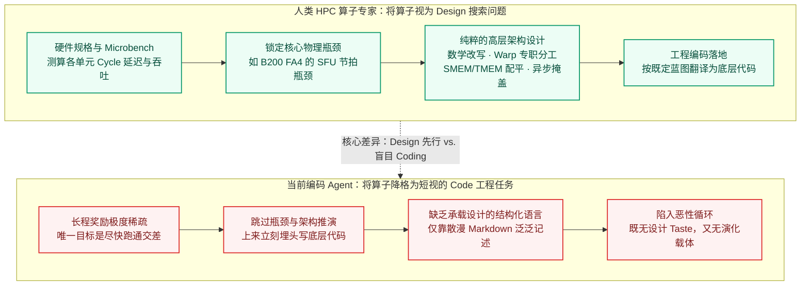

反观现有的编码 Agent，恰恰陷入了与人类专家截然相反的错位循环：

- **奖励稀疏诱发短视编码**：在当前任务定义与强化学习（RL）范式下，Agent 拿到的核心奖励信号是“交出一份能编译通过、能跑过测试的代码交差”。面对长程优化任务中极度稀疏的有效奖励，Agent 会表现得非常短视——跳过前置瓶颈推演，一上来就立刻编写底层代码；
- **缺失承载设计的语言载体**：更致命的是，Agent 手中没有任何形式化载体去精确记录、审视和演进自己的算子设计，最多只能用散漫的自然语言 Markdown 泛泛写几句总结，既缺乏结构约束，也无法检验逻辑自洽性。结果便是：**它一方面缺乏对高层设计的敏感度与品味（Taste），另一方面又缺失“做设计”的表达载体与推演能力，二者相互锁死成恶性循环。**

**一句话总结前文三大挑战的总根源：人类把算子开发当成高层的软硬件协同 Design 问题，而现有 Agent 把它当成了底层的 Code 工程任务。**

### 4.2 破局总蓝图：以 Kernel Schema 承载设计并重塑生成闭环

找到了这一总根源，破局的切入点便豁然开朗：**我们必须在所有具象 GPU 编程语言之上，建立一套能够精确记录、校验、维护算子“纯粹设计”的高压缩表达语言——Kernel Schema，并将其深度接入自动化迭代 Loop 之中。**

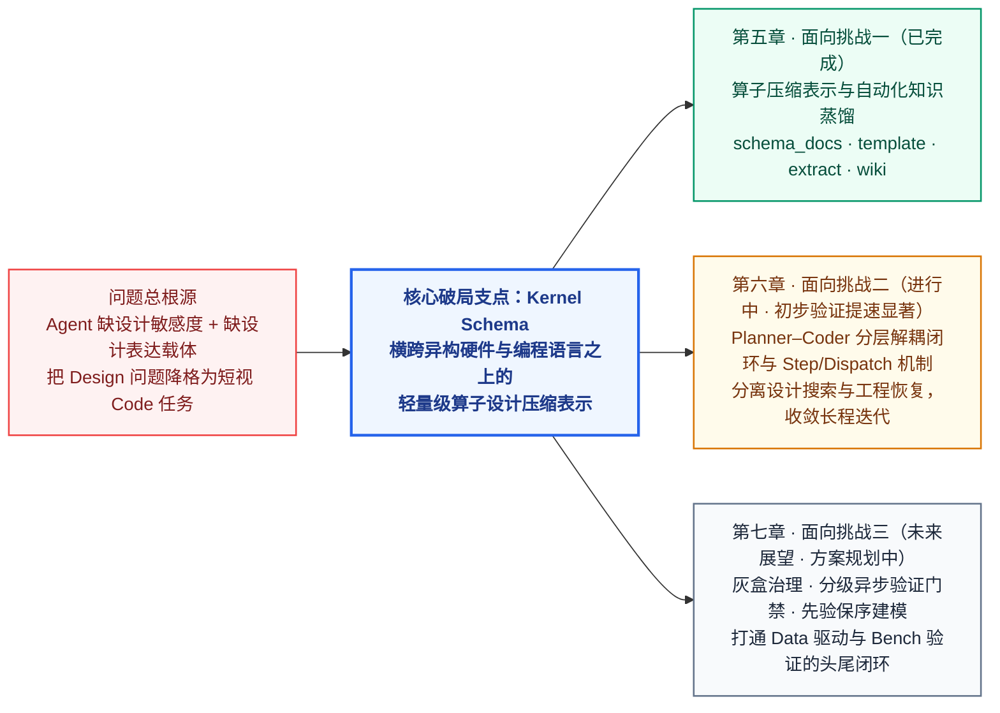

围绕这一破局路径，下文第五章将首先完整展开我们针对**第一个核心问题（事前 · 硬件感知、数据蒸馏与设计语言层）**已全面落地的系统性工作与实验验证；针对第二个问题（分层优化闭环）与第三个问题（白盒维护治理）的工作与展望将在后续第六、七章依次展开。

---

## 五、面向挑战一：基于 Kernel Schema 的算子压缩表示与自动化知识蒸馏

为了彻底打破“语言是思维的边界”与“原始代码语料未压缩、重编程轻硬件”的桎梏，我们提出了面向任意异构硬件与任意模型架构的轻量级算子表达语言 **Kernel Schema**，并围绕它构建了从**语法规则定义（**`schema_docs`**）**、**形式化检查与压缩工具（`schema_template`）**到**全自动算子蒸馏管线与知识库（`schema_extract` & `schema_wiki`）**的完整技术闭环。

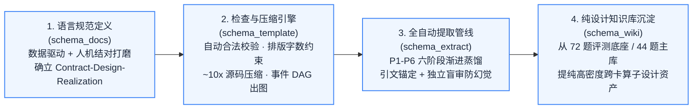

---

### 5.1 数据驱动与人机共创：跨硬件、跨语言的算子设计语言（`schema_docs`）

要设计一门能够通吃各类异构推理卡（不同硬件 Feature）与各类模型结构（不同数学规格）的高层算子语言，本质上是一个**数据驱动（Data-Driven）的规律提炼与信息压缩问题**。业界近期的 CAKE-IR 虽同样尝试从大量 Kernel 中归纳调度表达，但其既不开源，又绑定在专用编译降级链条上。我们的目标是构建一层**比编译器 IR 更高阶、无需编译即可独立承载完整性能因果、对 Agent 与人类专家双向友好**的通用设计表示。

在研发方法论上，我们深刻认识到：**现阶段大模型擅长发散铺陈，却并不擅长做高维本质压缩——而压缩恰恰是智能涌现的必要条件。** 因此，`schema_docs` 中的每一层抽象与每一个字段规则，绝非交由 Agent 凭空捏造，而是基于大量真实 SOTA 算子样本，通过**“AI 深度拆解源码事实 + 人类专家把控物理意义与设计取舍 + 对话式反例推演”**的结对共创模式反复收敛得出。我们严格遵循奥卡姆剃刀的**“删除测试”原则**——凡是删掉后不会导致读者误读或遗漏核心性能设计的字段与描述一律砍除，确保每一个保留字段都承载不可替代的设计信息。

在顶层结构上，一份完整的 Kernel Schema（除记录任务与来源身份的轻量 `META_DATA` 外）由职责边界极其清晰的三大区域组成：**不可变的任务契约（**`Contract`**）、承载核心智慧的三层设计（**`Design`**）与少量的实现交接约束（**`Realization`**）**。

#### （1）`Contract` 区：锁定外部边界，以“分层硬件 Wiki + Microbench”重塑硬件感知

算子开发的本质是在**固定硬件平台**上完成**特定数学输入输出要求**，因此 `Contract` 区对下游设计者与编码者均严格只读，分为软件与硬件两翼：

- **软件算法要求（**`Algorithm_requirement`**）**：以纯数学视角锁定输入输出张量规格、有效参数域、原位副作用及对齐 PyTorch `reference + tolerance` 的客观误差判据，剥离任何具体实现假设。
- **硬件平台规格（**`Hardware_specification`**）与分层 Wiki 创新**：我们明确摒弃了将“原始算子源码库”直接当作参考喂给 Agent 的传统做法——未经蒸馏的源码充斥着语法噪音，不仅严重侵占上下文窗口，还会误导 Agent 照搬不匹配的旧卡写法。相反，我们在硬件契约中只登记改变设计空间的关键执行层级与特性（如 Cluster、TMEM、CTA-pair），并将底层细节解耦为结构化的**分层 Wiki 体系**（架构能力 `Hardware`、编程栈语义 `Programming`、性能剖析 `Profile` 等）。  
其中最核心的突破在于专门设立并强调 **Microbench Wiki**（`Microbench`）：针对目标卡的不同计算、访存与特殊函数单元开展指令级实测，直接记录典型 Tile 规模下各硬件原语的真实执行周期（Cycle）与吞吐关系。借助这一分层先验，Agent 在构思之初就能直接拿到清晰的定量账本，无需在编码阶段盲猜或现场测算“一次矩阵乘耗费 512 周期与一次 `exp2` 耗费 1024 周期之间的掩盖比例”，从根本上补齐了早期硬件感知拼图。

#### （2）`Design` 区：由宏入微的三层递进设计金字塔（核心灵魂）

`Design` 区是整套 Schema 承载软硬件协同语义的核心，我们将其显式解构为层层递进的三个正交层次：**数学变换（**`Math_reshape`**）→ 工作调度（**`Work_schedule`**）→ 微流水线（**`Tile_pipeline`**）**。

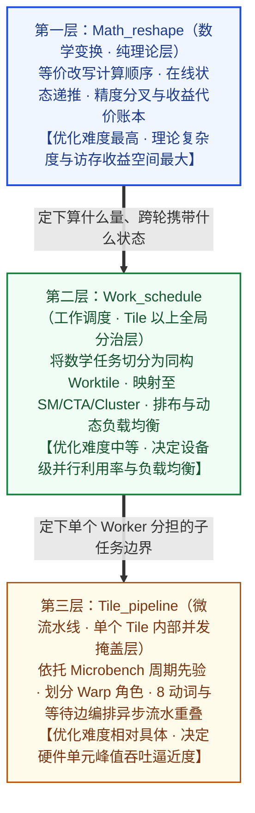

这三层构成了一座清晰的决策金字塔——自上而下抽象粒度由粗到细，**优化难度从高到低，而所能撬动的性能收益空间则从大到小**，且全程不混入任何一行 Host 启动代码、IO 声明、内存分配或底层 Layout 代数：

- **第一层 ·** `Math_reshape`**（数学变换）**：聚焦纯理论层面的等价计算重排或有界精度折中（如分块矩阵乘、Online Softmax、线性注意力逐块三角逆展开），从源头削减计算复杂度、缩短串行依赖深度或省去全局内存中间物化，并通过定量的 `Ledger` 账本核对收益与代价。例如 `FA4 Prefill` 中引入滞后阈值 $\tau=4$ 跳过非必要重缩放、分子窄化为 FP8 而分母保留未舍入 FP32 累加的核心设计，仅需十余行即可精准定格：

```yaml
# 摘自 schema_template/examples/fa4_prefill/root.yaml (DESIGN.Math_reshape)
- Name: online
  Math: |
    keep=(c*(mhat(i-1)-safe)>=-tau); mhat(i)=mhat(i-1) if keep, otherwise a; base=mhat(i-1) if keep, otherwise safe.
    alpha(i)=1 if keep, otherwise exp2_fast(c*(mhat(i-1)-safe)); stats(i)[r,:]=(mhat(i-1),base).
    exponentials(i)[r,k]=exp2_fast(fma32(c,maskedscore(i)[r,k],offset-c*base)); prob(i)=fp8_e4m3fn(exponentials(i)).
    ell(i)=alpha(i)*ell(i-1)+sum32_k exponentials(i)[r,k]; numerator(i)=mma32(prob(i),vc(i),alpha(i)*numerator(i-1)).
    invell=1/ell(tile_count-1) if ell is nonzero and not NaN, otherwise zero; oblock=bf16(numerator(tile_count-1)*invell).
  Ledger:
    Baseline: FP32 softmax weights in both numerator and denominator
    Gain: FP8 PV with bounded per-work online state
    Cost: FP8 numerator rounding, lagged maximum (tau=4) and approximate exponentials; denominator uses unrounded exponentials
```

- **第二层 ·** `Work_schedule`**（工作调度）**：聚焦单个 Tile 以上的宏观并行规划。它将改写后的数学任务分治切分为可统一处理的子任务单元（`Worktile`，显式区分块内常驻复用的 `Invariant` 与逐轮流式刷新的 `Iteration`）及其归并过程，映射到具体硬件资源（如单 CTA 或 2-CTA Cluster），并明确任务排列顺序、静态步长常驻或原子票据动态队列负载均衡：

```yaml
# 摘自 schema_template/examples/fa4_prefill/packed_persistent.yaml (DESIGN.Work_schedule)
Decomposition:
  Partition: {cluster_tile: {size: cpad, tile: 1, meaning: cluster tile coordinate}}
  Worktile:
    Invariant: {qc: {shape: [{row: packedrows}, {channel: channels}], dtype: fp8_e4m3fn, meaning: qc operand block}}
    Iteration:
      kc: {shape: [{key: kvblock}, {channel: channels}], dtype: fp8_e4m3fn, direction: ascending, meaning: kc operand block}
      vc: {shape: [{key: kvblock}, {channel: channels}], dtype: fp8_e4m3fn, direction: ascending, meaning: vc operand block}
Mapping:
  Worker: {unit: cta, unit_count: 2}          # 2-CTA 协作构成单个逻辑 Worker
  Placement: {unit: cluster, unit_count: 1}
  Worker_count: min(74,cpad)                  # 常驻 74 组 CTA Pair 复用流水状态
Schedule:
  Worker_assignment: {Preassigned: {start: worker_id, stride: worker_count}, Refill: none, Exit: assigned_done}
```

- **第三层 ·** `Tile_pipeline`**（微流水线）**：深入单个具体 Tile 内部，结合 `Microbench` 周期信息，将不同 Warp / Warpgroup 划分为专职角色，仅用 **8 个跨平台封闭基础动词**（数值计算 `compute / matmul`、搬运访存 `load / store`、顺序同步 `await / signal`、资源占用 `acquire / release`）与 **3 类显式等待契约**（数据就绪 `Prepared`、槽位释放可覆写 `Released`、协议放行 `Allowed`）精细刻画片上存储复用与指令级并发掩盖：

```yaml
# 摘自 schema_template/examples/fa4_prefill/packed_persistent.yaml (DESIGN.Tile_pipeline · MMA 角色)
Pipe:
  - for(t):
      - load:work(t)
      - if(valid(t) and tile_count(t) > 0):
          - acquire:scoreslot(n[t,0])
          - for(d): [matmul:qk(n[t,0],d)]
          - for(n[t,1:]):                     # 稳态主循环：当前块 QK 与上一块 PV 交错推进
              - acquire:scoreslot(n)
              - for(d): [matmul:qk(n,d)]
              - for(d): [matmul:pv(n-1,d)]
          - for(d): [matmul:pv(n[t,tile_count(t)-1],d)]
Waiting:
  Prepared:
    - '{issue matmul:qk(n,d)} ← [{done LOAD_QK[*]::load:qc(t,d)}, {done LOAD_QK[*]::load:kc(n,d)}]'
    - '{issue matmul:pv(n,d)} ← [{done SOFTMAX[*]::compute:prob(n)}, {done LOAD_V[*]::load:vc(n,d)}]'
  Released:
    - '{done acquire:scoreslot(n+2)} ← [{done SOFTMAX[*]::load:score(n)}]'   # 双槽缓冲安全回绕条件
```

#### （3）`Realization` 区：守住关键原语底线的前置约束

`Realization` 区仅作为轻量补充，通过 `Require / Prefer / Forbid` 锁定少量决定高层方案能否在物理上成立的关键原语或预算硬边界（例如在 Blackwell 上显式要求使用 `tcgen05` 与 TMA，禁止退回 `mma.sync`），而不干涉常规代码组织。

---

### 5.2 形式化检查、十倍级压缩与微流水线可视化（`schema_template`）

有了清晰的语言定义，还必须通过工程手段保证 Agent 写出的每一份 Schema 都结构合法、风格统一、极度精炼且逻辑无死锁。为此，我们在 `schema_template` 中构建了一整套自动化检查、规范化与可视化工具链（核心入口 `check_yaml.py`），并打磨了 `FA4 Prefill`、`FA4 Decode`、`GDN Prefill`、`QSA Prefill` 四个代表性前沿算子的标准样板：

1. **自动合法性校验、排版统一与刚性字数门禁**：工具自动执行字段结构校验、跨区符号与属性绑定检查，以及大小写、引号与格式的幂等自动排版；同时内置**字段级严格字数与行数上限**（例如三层 `Thesis` 不超过 2 行、`Math` 单条不超过 10 行、动作说明不超过 1 行），从机制上杜绝了 Agent 堆砌废话，将单份完整算子设计稳定收敛在 **300～500 行**的黄金阅读区间。
2. **约 10 倍量级的源码信息蒸馏压缩**：在标准样板实测中，`FA4 Prefill` 的主核实现代码高达 **4,040 行**（含归并与接口模块更逾 8,800 行），而提炼核心决策后的 `root.yaml` 仅 **384 行（主核压缩比达 10.5×）**；`GDN Prefill` 可读核心源码 **5,938 行**，压缩后完整 Schema 仅 **482 行（压缩比达 12.3×）**。以极小的上下文开销完整保留了一阶性能因果，真正为 Agent 提供了趁手、干净的“设计记忆载体”。
3. **微流水线形式化验错与事件依赖图自动生成**：由于 `Tile_pipeline` 具备严格的动作与等待形式化语义，`check_yaml.py` 可直接在指定样本参数下展开代表性 Worker 的循环与分支，构建操作级 `issue / done` 事件有向图，自动排查重复动作、悬空事件引用与同步死锁环路，并一键渲染出人类可读的微流水线并发依赖图。


> *图：*`check_yaml.py --graph png` *根据* `fa4_prefill/root.yaml` *自动展开校验并渲染的片内微流水线事件依赖图。图中各纵列对应* `LOAD_QK`*、*`LOAD_V`*、*`MMA`*、*`SOFTMAX`*、*`CORRECTION` *等专职硬件角色，有向边精确刻画了异步搬运、矩阵乘发射、在线重缩放与多槽缓冲释放回收之间的先后约束，无需编译底层 CUDA 代码即可直观审视并验证流水线设计的正确性。*

---

### 5.3 全自动数据清洗与知识蒸馏：从 `kernel_wiki` 到 `schema_wiki`（`schema_extract`）

语言与工具就绪后，下一步关键任务便是**“造数据”**——将散落在原始算子库中的隐性专家经验批量清洗、蒸馏出来，沉淀为支撑后续 Agent 跨卡跨算子推理的高密度设计知识库 `schema_wiki`。

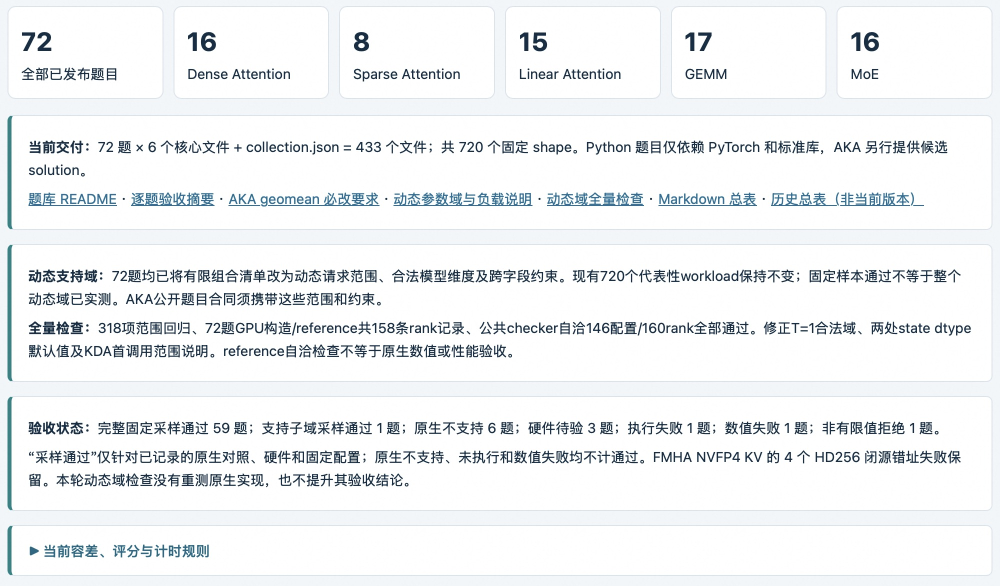

> *图：标准算子评测与源码题库底座（Kernel Wiki）建设看板。整体覆盖 Dense Attention（16）、Sparse Attention（8）、Linear Attention（15）、GEMM（17）、MoE（16）五大核心类别共 72 道动态支持域算子题目（含 720 个固定评测 Shape 与统一容差计时规范），为算子蒸馏与闭环验证提供了坚实的题库基础。*

在这一覆盖五大算子家族的 **72 题标准化题库底座**之上，我们将具备完整验证证据的 **L20D（B300）主批次 44 个算子**（含 20 个 AKA 优胜解与 24 个参考实现）导入 `kernel_wiki`，并设计实现了全自动离线蒸馏工具链 **Schema Extract**（`schema_extract`，统一入口 `extract_yaml.py`）：

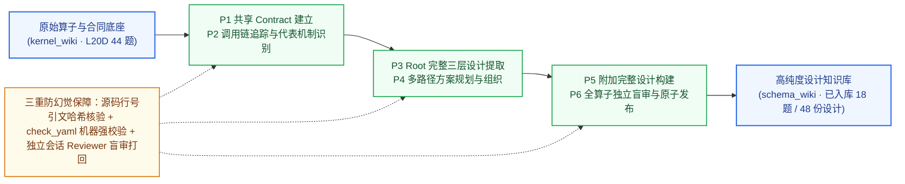

- **六阶段渐进提取与防幻觉闭环**：管线将复杂的源码逆向解构拆分为 **P1～P6 六个独立会话阶段**，每一阶段要求模型提交锚定精确源码行号与原文片段的结构化证据（由 Runner 校验文件哈希与原文匹配），经 `check_yaml.py` 规范化检查后，交由全新的只读 **Reviewer 会话**按“能否脱离源码独立读懂、分层是否准确、有无冗余或遗漏”进行盲审打回，直至 P6 全算子终审通过后原子发布并生成加密回执（`receipt.json`）。
- **国产模型全自动驱动与沉淀规模**：依托上述严密的约束协议，直接使用 `qwen3.8-max` 模型即可全自动、高质量地推进复杂算子提取。目前已在 L20D 44 题主库上顺利完成首批 **18 个代表性复杂算子、共 48 份完整设计**的入库发布（例如将 `bf16_nvfp4_gemm` 高达 18,450 行的多路径候选源码凝练为 7 份正交设计共 1,887 行）。未来 Agent 检索 `schema_wiki` 时，获取的不再是夹杂着特定 DSL 语法教学的冗长代码，而是高度提纯的“同卡其他算子 / 同算子其他卡”核心设计范式。

---

### 5.4 初步效果验证：无外部参考下 Schema 引导从零生成消融实验

为了直接检验“将算子核心设计压缩为 Kernel Schema 能否实质性改善编码 Agent 的生成与收敛表现”，我们在尚未引入第六章复杂双层架构的前提下，设计了一组**最纯粹、最严苛的最小可行性消融实验（Prompt-only Schema Injection）**：

- **实验设置**：选取 **GDN Prefill（17 shapes）、FA4 Prefill（30 shapes）、FA4 Decode（30 shapes）、QSA Prefill（4 shapes）** 四个极具代表性的前沿复杂算子，在 Agate L20D（SM103）平台上使用 `CuTeDSL` 从零编写算子。**完全关闭一切外部 Wiki、开源仓库与联网检索**，在相同的简化版 AKA-light 循环下开展 **4 算子 × 2 组（Schema vs. Control）× 3 次独立重复 = 24 路**隔离对照——唯一的变量在于，实验组（`Schema`）在每轮迭代提示词中直接给出简短的 Kernel Schema，要求 Agent 遵循该“设计解题思路”进行复现。

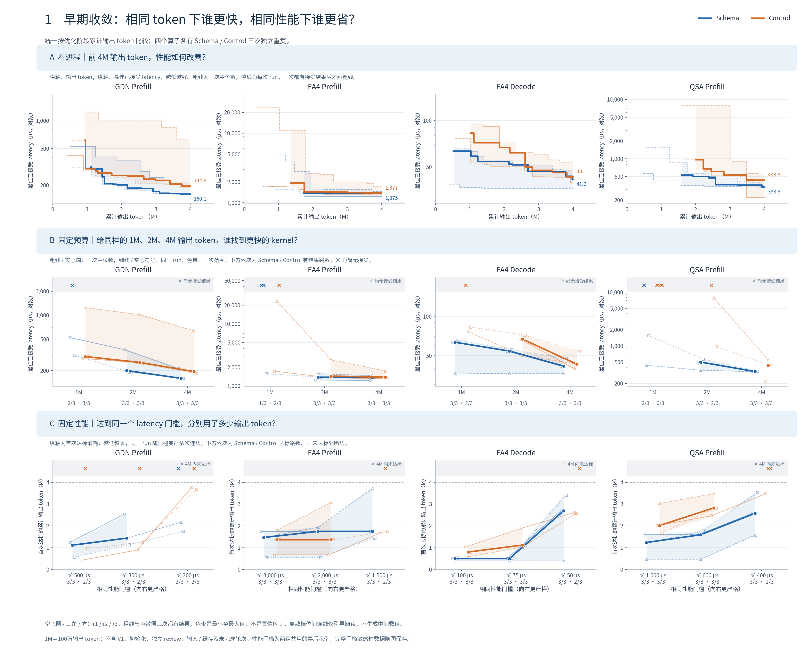

> *图：前 4M 累计输出 Token 内的早期收敛轨迹与达标预算对比（蓝色为* `Schema` *组，橙色为* `Control` *基线组）。纵轴采用对数延迟坐标，越低代表算子越快。*

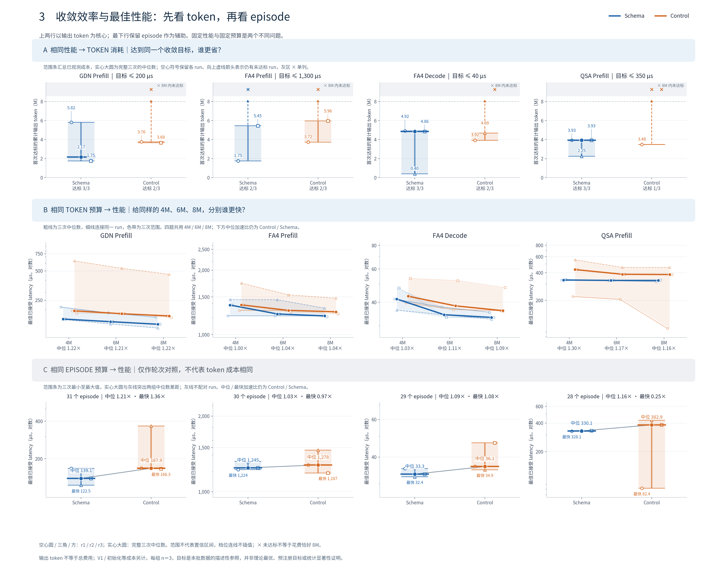

> *图：固定性能目标下的首达 Token 消耗（A 行）、固定 4M/6M/8M 输出 Token 预算下的最佳延迟与中位加速比（B 行），以及共同迭代轮次窗口末的分布与极值对比（C 行）。*

综合实验结果与稳定性统计，Kernel Schema 展现出了三个层面的清晰规律与深刻启示：

1. **大幅加速早期收敛起飞，同等性能目标下节省约 40%～50% Token 成本**

   有了高层设计蓝图指引，Agent 显著减少了早期在错误方向上的盲目试错：
   - 在结构复杂的线性注意力 **GDN Prefill** 上，达到 `≤200 µs` 高性能门槛时，`Schema` 组 **3/3 全员达标**，最快两路仅耗费 **1.75M / 2.17M** 输出 Token；而 `Control` 组仅 2/3 达标且首达耗费 **3.68M / 3.76M** Token，**节省近一半探索预算**；
   - 在稀疏注意力 **QSA Prefill** 上，前 1M 输出 Token 内 `Schema` 组已有 **2/3** 产出有效接受解，而 `Control` 组为 **0/3**；收严至 `≤350 µs` 目标时，达标率为 **3/3 对 1/3**；
   - 在 **FA4 Decode** 上，面对 `≤40 µs` 严格门槛，`Schema` 组同样实现了 **3/3 对 2/3** 的更高达标覆盖，且早期前 2M Token 内的下探斜率显著更陡。
2. **显著收紧跨 Run 随机离散度，消除“掉队慢路”并稳步抬升典型性能**

   在跨重复实验的一致性（几何标准差 GSD 越接近 `1.0` 越稳定）与等预算加速比上，Schema 起到了强力的“收敛锚点”作用：
   - **GDN Prefill 实现中位、最慢与最快全面领先**：在 4M / 6M / 8M 三档输出预算下稳定保持 **1.21×～1.22×** 的中位加速，共同窗口末最快解实现 **1.36×** 加速（`122.5 µs` vs `166.3 µs`，后续进一步下探至 `108.4 µs`），跨 Run 几何标准差 GSD 从基线的 `1.57` 大幅收紧至 **1.17**，彻底消除了基线组长期卡在 `365.9 µs` 的次优慢尾；
   - **FA4 Decode 与 QSA Prefill 稳住高质量下界**：`FA4 Decode` 在 6M～8M 预算下取得 **1.09×～1.11×** 中位加速，后段 GSD 从 `1.17` 收紧至 **1.04**（消除了基线组停留在 `46.6 µs` 的慢路）；`QSA Prefill` 在 4M～8M 预算下取得 **1.16×～1.30×** 中位加速，GSD 更是从 `2.50` 收紧至近乎完全重合的 **1.01**。
3. **边界现象的深度归因：为什么单层静态注入还不够？（直指第六章的核心动机）**

   客观审视图表，两处耐人寻味的边界现象恰恰揭示了更深层的机制规律：
   - 其一，在 **FA4 Prefill** 上，虽然 `Schema` 组将单路迭代最大回弹中位数从 `0.75%` 显著压低至 **0.24%**、提高了 `≤1500 µs` 达标率（`3/3` vs `2/3`）并支撑了超 80 轮的长程平稳演进，但两组中位延迟差距较小（约 **1.03×～1.04×**）。这是因为一方面基础注意力前向是模型相对熟悉的先验区间；更关键的是，Blackwell 上极致 FA4 涉及双 CTA、`tcgen05`、TMEM 与双路 Softmax 的高度精密耦合——**仅靠在单层编码 Agent 的 Prompt 中静态塞入一份简短 Schema，缺乏独立的落地忠实度检验与瓶颈诊断时，单层 Agent 很难仅凭自觉将高难度微流水无偏差地完全兑现为底层代码**。
   - 其二，在 **QSA Prefill** 上，三条 `Schema` 路极稳定地收敛至 `~330 µs` 平台，但有一条 `Control` 路偶发突破到了 `82.4 µs`。这精准印证了**“单一静态 Schema 先验”的双刃剑效应**：固定一份静态设计能带来极高的早期确定性与下界保障，但一旦触及该初始设计自身的上限，被静态约束锁住的单层编码 Agent 便无法主动跳出当前设计去搜索更优的新一代 Schema。

> **阶段小结与承上启下**：上述消融实验有力证明，**仅将算子压缩为数百行 Kernel Schema 作为静态解题先验，便能显著加速早期收敛、节省近半达标成本并大幅消除跨 Run 离散慢尾**——这验证了 Kernel Schema 确实抓住了算子性能的一阶因果，绝非边际修饰。同时，`FA4 Prefill` 的落地兑现瓶颈与 `QSA` 的静态平台边界也清晰表明：**要彻底释放 Schema 的威力，必须从“静态塞给单层 Agent 一份固定蓝图”升级为“由动态演进的 Planner 自主搜索更优 Schema、由专职 Coder 忠实落地验证并双向反馈”的分层解耦闭环**——这正是我们下一阶段（第六章）聚焦解决的核心命题。

---

## 六、面向挑战二：基于 Schema 的 Planner–Coder 两阶段解耦与闭环迭代

解决了算子设计“如何压缩表达”的语言与数据问题后，下一个核心命题便是**“如何将 Schema 真正用起来，破解长程迭代中的收敛离散性、设计-实现强耦合与稀疏奖励短视困境”**。我们的答案是：**拒绝在单一循环里混杂策略思考与工程改码，引入极简轻量的 Planner–Coder 两阶段解耦闭环。**

---

### 6.1 解耦哲学：以极简双角色闭环取代臃肿的 Loop Engineering

面对自动化算子生成的搜索难题，当前不少研究工作（如 `KernelForge` 的重型 MCTS 树搜索与部署桥接，或各类堆叠总控、测试、规划、编码、合并等四五个 Agent 角色乃至嵌套多级 RSI 的系统）走向了纯工程堆砌的 **Loop Engineering**——系统层级越重、角色越多，跨角色通信的信息损耗、状态管理开销与上下文稀释就越严重。

与之相对，类似 **Humanize** 所展现的极简双角色机制给出了极具启发的轻量化范式：**只需要两个职责正交的身份——一个专注独立审视并提出高层改进意见，另一个专注将意见工程化落地执行**，无需繁琐的多角色编排，就能构成紧凑高效的自闭环。

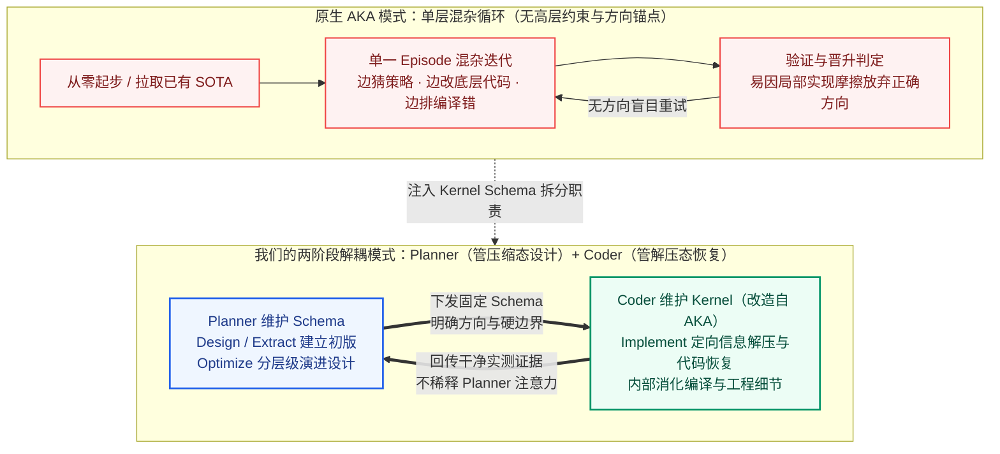

审视我们现有的 **AKA（Atrex-Kernel-Agent）** 基础设施：原生 AKA 的工作流是从零开始或拉取已有 SOTA 算子后，直接在每个 Episode 内不断尝试代码修改、编译评测与晋升。这套工程底座非常扎实，已经完整打通了自动化评测与迭代闭环；但正因为缺乏高层设计锚点，它本质上是一个**“无约束、无明确方向的 Optimize + Implement 混杂循环”**。

因此，我们在完整复用 AKA 强大底层执行闭环的基础上，以 **Kernel Schema** 为唯一交接契约，将其干净利落地拆分为两阶段身份：

- **Planner（设计维护者 · 操作压缩态 Schema）**：彻底脱离底层语法与编译琐事，专注在百行级的高信噪比空间中把控设计方向；
- **Coder（实现维护者 · 操作解压态 Kernel）**：将原生 AKA 改造为受控的工程实现引擎，专注在固定 Schema 边界内把高层设计还原为高性能代码。

---

### 6.2 核心运转流程：双起点汇流、分层级优化与“Schema 设计遗传树”

在两阶段架构下，算子开发的全生命周期被拆解为四个边界分明的原子动作，并天然统一了**“从零构建”**与**“从已有 SOTA 继续演进”**两条业务路径：

1. **双起点统一汇入初始 Schema**：
   - **从零开始（From Scratch）**：由 Planner 执行 **Design**，结合任务 `Contract` 与 `schema_wiki` 中邻近相似算子的设计范式，构建首版完整 Schema；
   - **从已有 SOTA Kernel 开始**：先由 Planner 执行 **Extract**，将现有 SOTA 源码逆向蒸馏为忠实的初始 Schema。
2. **Implement ↔ Optimize 协同演进双循环**：
   - **Implement（Coder · 信息解压与工程恢复）**：Coder 接收 Planner 锁定的 Schema，将其视作不可违背的设计蓝图进行“解压还原”——集中精力在若干个受控 Episode 内解决语法细节、内存偏移、屏障配对与局部参数调优，无需再漫无目的地发散摸索。
   - **Optimize（Planner · 金字塔分层演进）**：Planner 接收 Coder 回传的干净结构化实测反馈，结合 `Microbench` 等分层硬件 Wiki，严格按照 Schema 金字塔自顶向下的顺序——先审视 `Math_reshape` 能否改写计算路径、再权衡 `Work_schedule` 的分块映射与负载均衡、最后精调 `Tile_pipeline` 的并发掩盖——针对性地迭代优化 Schema 本身，给出下一轮明确的设计方向。

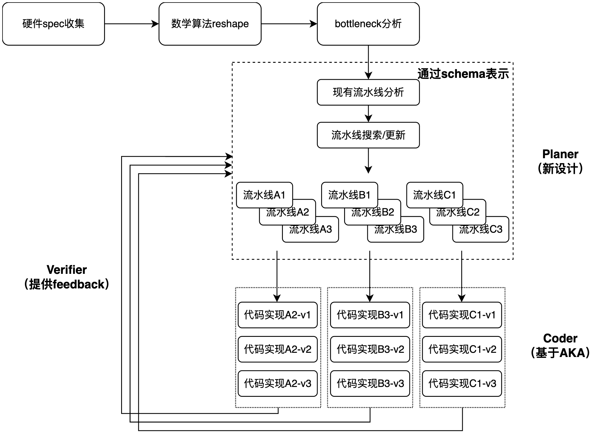

> *图：基于 Kernel Schema 与 AKA 的两阶段协同优化总框架。Planner 在 Schema 表示层结合硬件规格、数学改写与瓶颈分析搜索演进候选流水线（Pipeline A/B/C）；基于 AKA 的 Coder 针对选定 Schema 定向生成多个工程实现版本；Verifier 将实测性能与诊断反馈回传 Planner 驱动下一轮设计迭代。*

更重要的是，由于不同算子设计方案之间天然存在先验继承与分叉演化的祖先依赖关系，将设计与代码分离后，Planner 可以在高层直接维护一棵清晰的**“Schema 设计遗传树（Design Genetic Tree）”**：

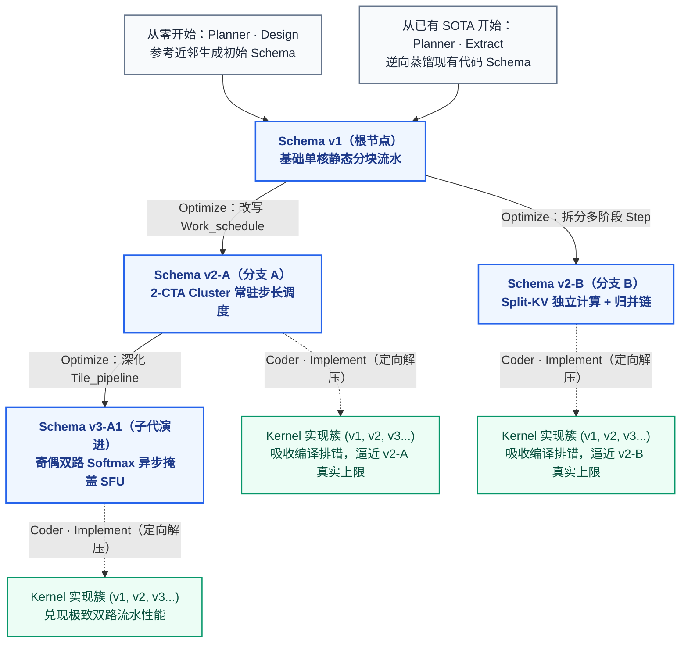

在这一模式下，底层单次编译报错或指针 Bug 全部被隔离在叶子下方的 Coder 实现簇内部消化，绝不会污染 Planner 的上下文窗口，更不会导致一条潜藏高上限的流水线分支在尚未写对代码前就被草率淘汰——**Planner 得以保持极度干净的注意力聚焦于设计空间的树状探索，而 Coder 则拥有无比明确的任务边界。**

---

### 6.3 支撑长程复杂算子演化的两大关键机制：`Step` 与 `Dispatch`

在将 Kernel Schema 真正推向复杂生产算子的长程迭代优化时，我们进一步提炼并打磨了 Schema 内部的两个关键表达机制——**Step**（`Step`）与 **Dispatch**（`Dispatch`）。二者分别从**“算子内部纵向阶段边界”**与**“跨负载横向分支切换”**两个维度，赋予了 Agent 在超长程探索中既高度自由又收敛可控的演化能力。

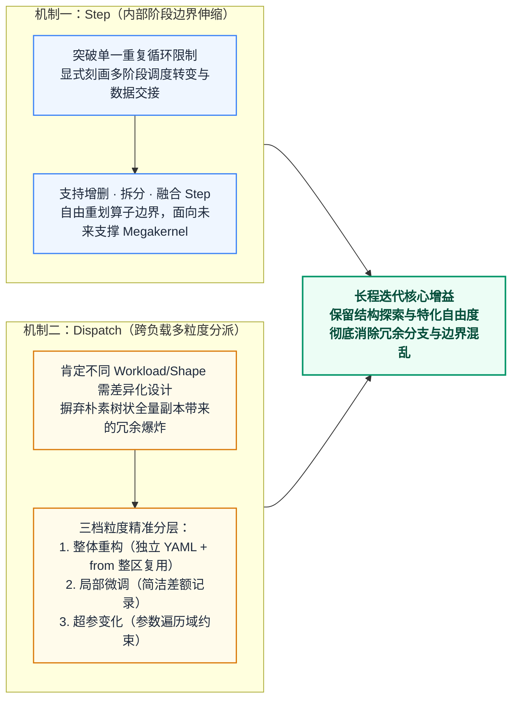

#### （1）`Step`：刻画工作调度转变与阶段交接，赋予算子边界自由伸缩的完备性

在设计 `Work_schedule` 与 `Tile_pipeline` 的过程中我们敏锐意识到：真实的工业级复杂算子绝非从头到尾只有单一、同构的循环体，**算子任务内部天然存在着明确的阶段边界与工作调度模式的转变**——同一个计算维度在前一阶段可能是完全独立并行的切分轴，进入下一阶段变成单个 Worker 内的串行递推轴，再到收尾阶段又转化为跨分片的规约归并轴（例如稀疏注意力中的“稀疏索引预处理 `Step` → 主注意力计算 `Step`”、长序列中的“分片计算 `Step` → 全局归并 `Step`”，或是融合 MoE 中跨越路由、分块矩阵乘、激活量化与聚合的多个 `Step`）。

通过引入显式的 **Step**（`Step`）表达及其跨阶段启动与数据交接契约（片上存储直传或全局内存交接），Kernel Schema 实现了两项决定性跃升：

- **保证任意复杂任务的描述完备性**：使 Schema 从只能刻画“单一功能重复循环核”扩展到能够严密记录任意多阶段复合算子的完整设计；
- **支持通过增删、拆分与融合** `Step` **探索边界级优化**：在长程迭代中，Planner 不再局限于单个循环体内部抠细节，而是可以通过主动拆分 `Step`（以额外中间物化换取更高并行度）或融合相邻 `Step`（省去全局内存往返与 Kernel 启动开销）来重塑算子计算边界，并天然具备了未来直接描述与演化 **Megakernel** 这类超大规模跨边界算子的语义潜力。

#### （2）`Dispatch`：锚定核心不变量与三级差异粒度，终结特化副本爆炸

前文挑战三曾指出，现有 Kernel Agent 倾向于堆砌海量分支特化来迎合不同 Workload 与 Shape。客观而言，**“针对不同硬件瓶颈区间的负载形状采用不同设计”这一物理思路本身是完全正确的**；真正的症结在于缺乏紧凑的分派表达方法。我们在实践中发现，如果简单采用朴素的树结构为每一个分支维护一份完整的 Schema 副本，由于其中混杂着整体架构调整、局部机制改动乃至纯粹的超参数微调，Schema 节点间会产生惊人的重复冗余（例如早期提取 MoE 时曾因不同层级的笛卡尔积配对衍生出 50 份高度重复的副本），不仅极难维护，更让人无法看清 Agent 分派决策的内在逻辑。

为此，我们引入了结构化的 **Dispatch**（`Dispatch`）表达机制——核心思想是**抓住算子跨变体的核心不变量，按变化程度分层级记录差异**：

1. **整体设计重构级**：当主计算路径、工作归属或核心微流水发生本质改变时，才建立独立的 `<id>.yaml` 设计节点，并允许通过无环的 `{from: id}` 直接整区复用未发生变化的 `Design` 层，彻底消除跨文件重复抄写；
2. **局部机制调整级**：当主体骨架保持不变、仅局部环节存在小幅改动（如调整某一步重缩放因子的共享方式）时，无需派生新文件，直接在 `dispatch.md` 中用极简的局部差额语言记录改动点、联动接口与适用条件；
3. **纯超参数调整级**：针对同一机制下的分块尺寸、Split 路数等数值调优，直接以参数变化条目界定可行遍历范围与资源预算边界。

借助 `Dispatch` 机制，Agent 在长程迭代中得以极其清醒地感知**“面对当前 Shape 性能短板，究竟应当在什么条件下做何种力度的分派——是做超参数遍历、做局部机制微调，还是彻底重写一套新流水设计”**，在充分保留差异化优化自由度的同时，从根源上遏制了冗余代码的无序膨胀。

---

### 6.4 工程闭环落地与 6 类典型算子实验进展

围绕上述两阶段解耦思想与 Schema 演化机制，这一阶段的工作重点在于工程闭环的全面贯通。目前我们已在两套代码体系中完成了端到端实现并跑通全链路：

1. **KernelSchema 独立模块化工具链与工作流**：在 `KernelSchema` 仓库中独立实现了 `schema_design`、`schema_extract`、`schema_optimize`、`schema_implement` 四大功能模块，并通过 `schema_workflow` 将其串联为轻量独立的串行自闭环，支持从零任务或已有源码出发独立完成完整的“设计—实现—实测—优化”循环。
2. **AKA-Schema 生产级分支深度改造**：在 `atrex-kernel-agent` 仓库中专门构建了集成 Schema 工作流的分支实现。当开启 Schema 模式开关后，系统自动从原生单层盲目探索切换为两阶段协同模式——将原生的多 Episode 迭代引擎改造为定向受控的 **Implement** 窗口以忠实兑现当前 Schema，并在窗口之间无缝嵌入 **Planner** 模块动态审视反馈、演进更新 Schema，实现了 **Schema 与 Kernel 的联合迭代优化**。

在实验验证方面，整套闭环管线已在真实集群环境中验证跑通。目前我们正围绕首批完成高质量蒸馏的 **6 类代表性算子任务**（涵盖 `FMHA MXFP8`、`FP8 Grouped GEMM`、`GDN Prefill`、`MLA FP8`、`NVFP4 MoE`、`Sparse Attention` 六种不同计算与访存特征的核心算子），以现有 SOTA Kernel 为起点开展两阶段 Schema 闭环的消融对照实验。受限于当前 L20D 算力资源紧张，完整的多算子长程对比实验仍在持续运行中；从前期已跑出的迭代轨迹来看，引入两阶段 Schema 闭环后已呈现出明显的收敛效率提升——**在相同的迭代耗时内能够更快速地突破瓶颈、稳定达到更低的算子执行延迟**。

---

## 七、面向挑战三与未来展望：灰盒治理、分层验证门禁与先验保序建模

针对第三个核心挑战——**“生成结果黑盒化、隐式缺陷难排查、生产可用性难以确认与维护”**，以及前文留下的**“如何预判硬件极限与最优收敛终点”**问题，我们在现有架构基础上展开了系统性的理论推演与未来研究规划。这一阶段的核心聚焦于三个方向：从黑盒走向灰盒的实用主义治理观、分阶段分层级的验证门禁与 Benchmark 体系，以及**基于 Schema 的早期先验性能建模**。

---

### 7.1 从“纯黑盒”到“半透明灰盒”：管住白盒设计传承，以实测定义实现正确性

对于生成算子难以理解与维护的困境，我们已经落地的 **Kernel Schema 实际上已经解决了最核心的一半问题——将原本彻头彻尾的代码黑盒，转化为了高层透明的“灰盒（Grey-Box）”**：

- **上半场（Schema 层白盒化与经验泛化沉淀）**：得益于精心打磨的紧凑语法、300～500 行的精炼篇幅与配套的可视化事件依赖图，算子最核心的算法改写与流水线决策已经变得对人类专家高度易读、易审阅、易确认。更重要的是，这些设计不再停留在 Agent 一次性对话的散漫自然语言里，而是变成了**可传播、可跨卡泛化、可跨轮累积的结构化经验资产**——长程迭代中涌现出的优秀设计发现可以被直接抽取固化下来，反哺后续算子开发，从根本上保障了核心设计层的可维护性。
- **下半场（Implement 层的务实工程路线）**：客观而言，我们能管住上层 `Schema` 的清晰可读，但很难强求 `Implement` 阶段自动生成的数千行底层代码同样易于人工逐行阅读。对此，我们秉持直接而务实的工程准则：**算子终究服务于真实生产环境，哪怕人类专家手写代码同样难免引入疏漏；既然底层工程代码天然难以靠肉眼逐行担保，那么“在真实运行环境与严苛完备的 Benchmark 中经受住充分检验、稳定可用”，本身就代表了算子实现的工程正确性。**

---

### 7.2 分级异步验证门禁与科学 Bench 设计：打通“Data 驱动 + Bench 验证”头尾闭环

确立了“以严苛验证定义实现可用性”的路线后，随之而来的工程矛盾非常突出：要彻底揪出 Agent 在迭代中的 **Reward Hacking（投机取巧）** 或共享内存竞争、极端边界越界等隐式 Bug，就必须依赖大规模测试集、动态边界用例与并发 Sanitizer；但在实际实验中我们明显观察到，**算子正确性与性能验证的串行等待，是拖慢整体迭代速度的最大瓶颈**。

为破解“测试完备度”与“迭代高吞吐”之间的矛盾，核心思路是在 `AKA / Implement` 侧引入类似 **Spira** 的**多层分级门禁（Multi-Level Gates）与异步验证机制**，并配套构建分阶段、分层级的科学测试集：

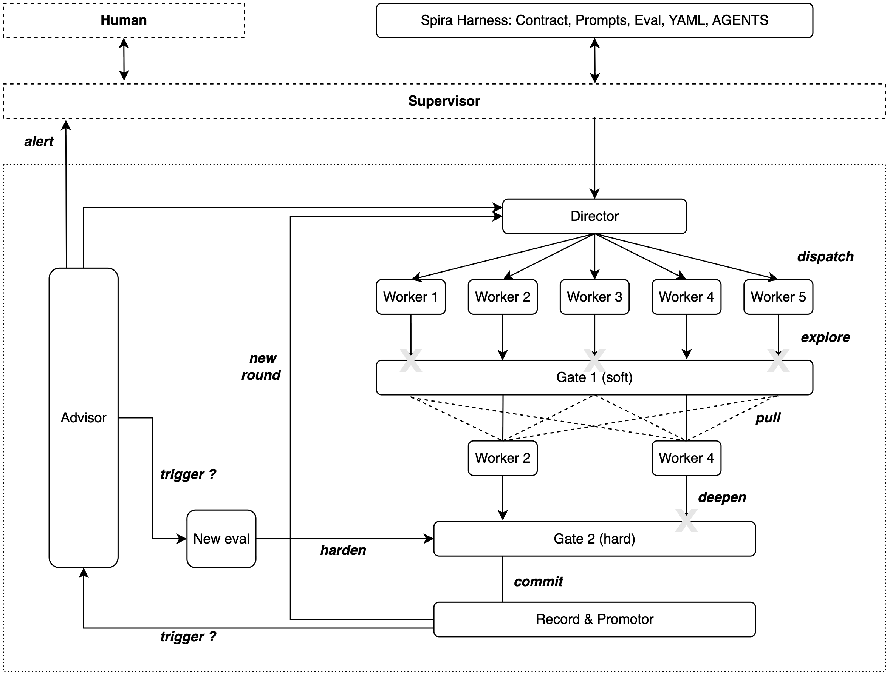

> *图：借鉴 Spira 漏斗思想的多层门禁筛选与动态评估加固机制。通过* `Soft Gate` *快速拦截绝大多数低级错误，仅将高潜候选推入* `Hard Gate` *开展深层验证，并支持由* `Advisor` *动态触发新评测加固门禁（*`harden`*）以防范投机与隐式缺陷。*

1. **由轻到重的多级 Gate 筛选 + 异步非阻塞推进**：
   - **轻量级初筛（Gate 1 · 快速拦截）**：利用编译检查、静态规则校验与极少量小 Shape 冒烟用例，以秒级代价拦截绝大多数语法、接口与基础逻辑错误；
   - **渐进式深测与压测（Gate 2/3 · 完备兜底）**：按复杂度递增的分层题目逐步检验动态边界正确性、生产负载分布下的综合速度指标（如加权 `Geomean`），并通过重型压测与 Sanitizer 严查极端并发隐患与长尾分数掉点；
   - **轻量放行、后台异步严测**：为了消除串行等待卡点，候选方案只要通过轻量级门禁即可**立刻放行返回主循环继续下一轮探索**，与此同时后台根据候选的重要程度（如是否刷新最优记录）**异步追加重型边界测试与压测**——一旦异步深测暴露出隐式错误或掉点，再精准触发告警或版本回滚，从而在保障生产级可靠性的同时跑满迭代效率。

```mermaid
flowchart TB
    subgraph LOOP_GATE["分级异步验证流水线：消除串行等待，严防 Reward Hacking 与隐式 Bug"]
        direction LR
        CAND["Coder 生成候选 Kernel"] --> G1["Gate 1：轻量级同步门禁<br/>编译检查 · 静态校验 · 冒烟小 Shape"]
        G1 -->|"快速通过 · 立即放行"| NEXT["立刻返回主循环继续下一轮迭代<br/>（主链路零阻塞）"]
        G1 -.->|"后台按重要度异步触发"| G2["Gate 2：中层动态域与性能题<br/>跨字段动态 Shape · 掩码/空块边界 · Geomean 测速"]
        G2 -.-> G3["Gate 3：重型上线准入压测<br/>全量盲测集 · Sanitizer 并发检测 · 防掉点监控"]
        G3 -.->|"发现隐式缺陷则告警回滚"| NEXT
    end

    subgraph HEAD_TAIL["自动化自进化 Loop 的头尾哲学：Data-Driven + Bench-Verified"]
        direction LR
        HEAD["头部：Data 数据集（第五章）<br/>Kernel Schema 与 Schema Wiki<br/>提供高压缩先验，承担 Data-Driven 引擎"] ==> MID["中部：Planner–Coder 解耦闭环（第六章）<br/>设计空间树搜索 + 受控工程恢复"] ==> TAIL["尾部：Bench 测试集（第七章规划）<br/>分阶段分层级正确性与速度基准<br/>锚定物理真值，承担 Bench-Verified 准星"]
    end

    classDef fastBox fill:#ECFDF5,stroke:#059669,stroke-width:1.8px,color:#064E3B
    classDef asyncBox fill:#FFFBEB,stroke:#D97706,stroke-width:1.5px,color:#78350F
    classDef loopCore fill:#EFF6FF,stroke:#2563EB,stroke-width:2px,color:#1E3A8A,font-weight:bold
    class CAND,G1,NEXT fastBox
    class G2,G3 asyncBox
    class HEAD,MID,TAIL loopCore
```

2. **首尾呼应的系统大局：头部做** `Data` **驱动，尾部做** `Bench` **验证**

   因此，如何设计一套覆盖全面广泛、同时在正确性判定与速度评估（如 `Geomean` 与分档阈值）上分阶段、分层级组织的科学测试题集，是我们接下来的重要发力点。站在全局视角回望：**我们前半程倾力打造的** `Schema Wiki` **是整个系统的“头”（高质量** `Data` **数据集），而这套分层门禁与评测基准则是整个系统的“尾”（高可信** `Bench` **测试集）——任何一个能够持续自进化的优秀 Loop，本质上都离不开“以 Data 驱动探索（Data-Driven）、以 Bench 锚定验证（Bench-Verified）”的头尾闭环。**

---

### 7.3 先验性能建模展望：基于 `Schema + Microbench` 的极限评估与“近似保序”筛选

最后，针对“如何判断当前迭代结果是否已逼近硬件最优极限（SOL，Speed-of-Light）”以及“能否在耗费高昂编码与 GPU 实测成本前提前甄别设计优劣”的前沿问题，我们展望了一条极具价值的研究路径——**基于** `Kernel Schema + Microbench` **构建轻量级先验性能建模工具（仿真/估算器）**。

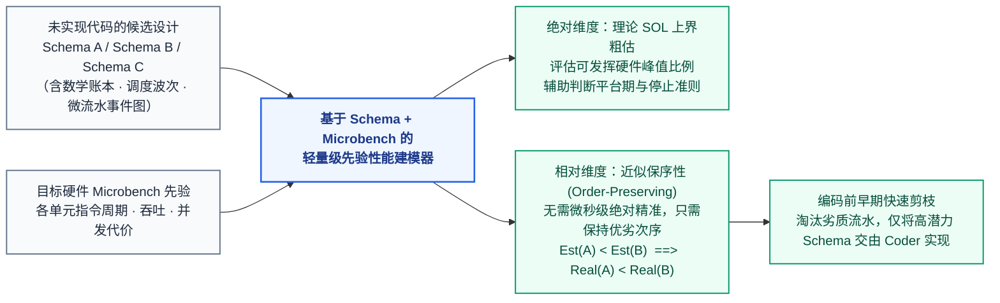

由于 Schema 已经显式结构化了计算访存账本、Worker 并行映射波次与片内微流水事件依赖图，将其与目标卡 `Microbench` 的实测单元周期与吞吐数据结合，即可从两个层次赋能迭代闭环：

1. **绝对上界参考（SOL 峰值发挥度估计）**：在给定硬件参数与 Schema 设计下，从理论上推演关键路径与最忙硬件单元的吞吐下界，初步评估该设计能够发挥多大比例的硬件峰值性能（SOL），从而为“当前算子距离物理极限还有多远、何时应当停止追加预算”提供先验标尺。
2. **相对候选比较——以“近似保序性（Order-Preserving）”化解精确仿真难题**：

   我们清醒地认识到，受底层编译器寄存器分配、指令发射争用与缓存动态行为影响，想要构建一个**既足够轻量快速、又能在绝对延迟数值上精准无误**的硬件仿真器难度极高。但在 Planner 探索未实现 Schema 的早期阶段，一个极其关键的洞察是：**横向筛选候选设计并不要求绝对数值 100% 精确，只要满足“近似保序性”便足以产生巨大价值！** 换言之，即便先验估计存在系统性偏差，只要模型判定“Schema A 优于 Schema B”时，二者充分实现后的真实硬件表现大概率保持同一相对次序，Planner 就能在未写一行底层代码前低成本淘汰次优方案、精准保留真正有潜力的 Schema 设计——这是一个兼具理论挑战与高工程回报的核心探索方向。

---

> **全文结语**：回到开篇的立意，围绕 **Kernel Schema** 展开的“算子压缩表示与知识蒸馏（事前 Data-Driven）— Planner 与 Coder 两阶段解耦演化（事中分层搜索）— 灰盒分级验证与先验保序建模（事后 Bench-Verified）”三步走实践，不仅直接回应了当下 MaaS 异构模型与芯片适配的迫切降本增效刚需，更在高性能算子这一兼具客观真值与高维深度的典型问题上，探索出了一条**把人类专家设计直觉形式化、让 AI 在紧凑语义空间高效自进化**的清晰闭环路径。

