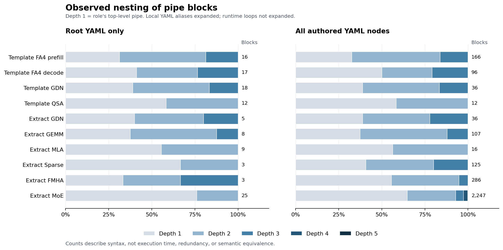

# Pipe 语法：旧写法分析与当前规则

前半部分保留四个模板与首批六个算子的旧写法审计；[后半部分](#pipe-规则)统一记录当前采用的有序列表与简单控制规则。新 pipe 写法及源码核对见[十个 root 的试写](trial_roots/README.md)；已确认的依赖设计见 [Waiting 依赖规则](#waiting-依赖规则)。

## 旧写法审计

以下统计覆盖 **193 份有稿 YAML、265 个算子内精确 pipe 写法组、2,025 个有效 role 使用位置**。十份独立报告及逐组、逐节点核对均已完成；统计和解释以冻结样本为准，不是新语法的字段定义。

主要发现是：**同一套 pipe 结构同时承担工作遍历、分量处理、流水填排、条件门控和 worker 生命周期；结构复杂度又有一部分留在域定义、动作契约和工作调度中。** 因而，嵌套层数、头尾字段数量和动作条数不能独立代表一份设计的复杂度。

**十个算子的结构统计。** 下表采用本地 YAML 展开 alias 后的口径 B；块层深从 role 顶层 pipe 的第 1 层起算。role 是文件中的使用位置，动作与块均未按运行时循环或成员数量展开。

| 算子报告                                             |      有稿节点 |            role |  pipe 块：root / 全部 |          嵌套块 |  最大块层深 |    精确写法组 |
| ---------------------------------------------------- | ------------: | --------------: | --------------------: | --------------: | ----------: | ------------: |
| [模板 FA4 prefill](operators/template_fa4_prefill.md) |            11 |              54 |              16 / 166 |             112 |           3 |            23 |
| [模板 FA4 decode](operators/template_fa4_decode.md)   |             7 |              48 |               17 / 96 |              48 |           3 |            19 |
| [模板 GDN](operators/template_gdn_prefill.md)         |             2 |              14 |               18 / 36 |              22 |           3 |            11 |
| [模板 QSA](operators/template_qsa_prefill.md)         |             1 |               7 |               12 / 12 |               5 |           2 |             7 |
| [提取 GDN](operators/extract_gdn.md)                  |             6 |              14 |                5 / 36 |              22 |           3 |             9 |
| [提取 GEMM](operators/extract_gemm.md)                |             7 |              40 |               8 / 107 |              67 |           3 |             6 |
| [提取 MLA](operators/extract_mla.md)                  |             2 |               9 |                9 / 16 |               7 |           2 |             9 |
| [提取 Sparse](operators/extract_sparse.md)            |             8 |              51 |               3 / 125 |              74 |           3 |            21 |
| [提取 FMHA](operators/extract_fmha.md)                |            43 |             159 |               3 / 286 |             127 |           3 |            51 |
| [提取 MoE](operators/extract_moe.md)                  |           106 |           1,455 |            25 / 2,247 |             792 |           5 |           109 |
| **合计**                                       | **193** | **1,851** | **116 / 3,127** | **1,276** | **5** | **265** |

四模板为 123 个 role、310 个块。MoE 占本地块总数的 **71.9%**，全库总量明显受其大分支树影响。13 个 MoE 节点引用父节点的完整 tile_pipeline；纳入引用后，MoE 为 1,629 个有效 role、2,517 个块。其他九个算子的 tile_pipeline 均本地定义，此处不评价其他区域的引用。



图中颜色表示语法块层深；root 与全分支分列，未把层深当作执行时间或冗余评分。[SVG](figures/pipe_depths.svg)

**几种最直接的语法现象。** 以下仍为口径 B，统计单位是块或列表，不是设计机制数。

| 现象                                    |                   数量 | 数字说明什么                                       |
| --------------------------------------- | ---------------------: | -------------------------------------------------- |
| 嵌套块仅含 `repeat+steady`            | 1,222 / 1,276（95.8%） | 子块大量用于重复动作序列；不是可删除比例           |
| 无 repeat、仅含 steady 的块             |                    193 | steady 也承担单次顺序列表的职责                    |
| 上述块中仍包含子块                      |                     51 | 外层本身不循环，但容纳内部循环或其他块             |
| 显式 repeat：域名 / 域选择 / 局部域定义 |      1,583 / 363 / 485 | 相同循环信息有不同写法；域选择包括 `n[t]` 等形式 |
| prologue / epilogue 中的直属循环        |                50 / 13 | 头尾本身也可能包含重复批次                         |
| 同一列表混合动作与循环                  |                    390 | 普通动作与局部循环按列表顺序交错出现               |

全体块的深度 1–5 分布为 **1,851 / 1,001 / 215 / 54 / 6**。所有 root.yaml 的最大块层深不超过 3。第 5 层只来自 MoE 三个 big_flat 验证节点的 fc2.Main：无 repeat 的根容器 → run 门控 → t 工作 → b 前项/末项 → c 读出片段。三个使用位置各有两个第 5 层 c 块；这不是五层同性质的数值循环。

**重复结构实际在做什么。** 下列用途来自逐算子的域、动作、依赖及外围定义核对，不按变量拼写自动分类。

| 用途               | 已观察到的写法与例子                                                                                                                                  |
| ------------------ | ----------------------------------------------------------------------------------------------------------------------------------------------------- |
| 工作与局部计算推进 | 模板 GDN、MLA、MoE 用工作序列与局部域组织持久推进；FMHA 的 g 则遍历一份工作的 attention/group-max 区间，不能把相似循环都称为持久调度                  |
| 分量与批次处理     | FA4 的 d 处理两个半片，GDN 的 j 处理成对 chunk，FMHA 的 t 处理 16-key 分量，c 与 k/j 处理通道和 split 批次；相邻循环保存分组先后                      |
| 填充、稳态、排空   | 模板 GDN ScalarOutput 把三段不同 j 范围并列放在 steady 内；QSA MMA 的子块显式带完整头稳尾；MoE flat 以截断范围预填并单列末项                          |
| 条件门控           | FA4 split 的 active/empty、提取 GDN 的 a/run、Sparse 的 v/e、MoE 的 run/active 使用 0/1 域，使一组动作存在或不存在                                    |
| worker 生命周期    | MoE 的 960 个四字段块中，946 个按 worker 范围执行进入、条件检查、完成等待或资源退出，14 个 flat 块表达局部预填/末项排出；字段齐全不等于同一种流水阶段 |
| 跨工作索引接续     | GEMM、MLA、QSA 与 MoE 中均出现连接不同工作阶段的连续编号；局部域切片和连续序号移位具有不同边界含义                                                    |
| 动作内部的流程     | FA4 joint 的单个 token 动作承载 QK/PV 次序映射；FMHA 的 64/16/1 扫描有三段显式循环、单批序列和单动作封装三种粒度；pipe 的浅层不等于内部流程少         |

这些用途解释了现有写法承担的任务，但不证明作者的心理动机。相同用途既可能显式展开，也可能由更大的动作承载；仅凭表面形状，无法归因于“偷懒”或某个提示。

**旧写法的解释问题与统计边界。**

1. **同一个 repeat 不是同一层次的推进。** 工件、归约批次、两个分量和 0/1 门控都使用它；块层深混合了真实循环、条件和顺序容器。理解执行含义需要同时解析域与所在作用域。
2. **头尾字段与头尾机制不一一对应。** 模板 GDN 的 36 个块没有显式 prologue/epilogue，仍有初态、预备与终态动作。FA4 root 的首末 QK/PV 列在 steady 内；MoE 的大量显式头尾属于 worker 协议。worker 一次与每 worktile 一次不能仅凭字段名区分。
3. **结构粒度不统一。** 有的片段把分量逐项展开，有的单动作内包含多次求值、读写、协作或条件分支。相同的实际流程可以对应不同深度，静态动作数也不能直接转成运算量。
4. **相同 pipe 不等于相同完整设计。** FA4 shared-rescale 与相应 LPT 管线相同而载荷不同；decode combine 同组在不同节点有不同空槽读取规则；MoE 有 46 个精确组关联多种契约。指纹未包含外围域、数学、调度和动作契约，其相等只是写法相等。
5. **空域、零数据和无操作载荷具有不同事件行为。** 有的条件使内部动作不存在，有的保留已有动作及其完成事件，有的仍参加空批次或末次交接。循环范围本身不足以说明全部空分支行为。
6. **产物或来源缺项与语法现象同时存在。** FMHA 包含空选择条件及数学/管线混稿；其他报告也记录了已有的读者退出、跨成员完成或观察状态限制。这些限制影响具体执行解释，但不是自动成立的新语法类型；结构可解析也不是源码行为已被证明的依据。

**范围与计量边界。** 审计时的 21 份模板与对应冻结副本全部同 hash，只计一次；六算子使用 2026-11-09 审计选定的 172 份有稿快照，语义解释采用该审计的规则快照。状态为 template 21、approved 145、review_candidate 13、needs_authoring 14。另有 5 份失败骨架、43 个未开始节点，不贡献结构计数。有稿不等于完整正确；上述分析保留样本原始动作标识，不将新试写计入旧写法统计。

| 口径        | pipe 块 | 静态动作 | 含义                                                            |
| ----------- | ------: | -------: | --------------------------------------------------------------- |
| A：源声明   |   2,693 |    7,579 | 文件内按 YAML 节点身份去 alias；跨文件复制仍计数                |
| B：本地展开 |   3,127 |    9,963 | 展开文件内 alias，不展开父区域引用                              |
| C：有效视图 |   3,397 |   10,867 | 再展开每节点的 tile_pipeline 父引用；保留 provider 与使用上下文 |

三者不能相加。265 个精确组按算子内解析后的 pipe 内容及顺序分组，并不代表 265 种独立设计。统计只描述声明结构，未展开运行循环、测量性能或证明全部契约语义。

[统计汇总](data/summary.json) · [逐算子 CSV](data/operator_counts.csv) · [来源清单](data/manifest.json) · [计量定义](data/schema.json) · [统计校验](data/validation.json) · [十份审阅的覆盖核对](reviews/coverage.json)

全部 193 节点、265 组及 2,025 个有效 role 使用位置均在审阅清单中覆盖；独立复算与报告质量复核通过。该审计未修改原始 YAML、正式规范、源码或提取运行状态，未执行 GPU。

## Pipe 规则

规则标识为 **`pipe-control-v0.2`**。pipe 记录一个 role 在其职责范围内的动作发起顺序，只采用 **有序列表、`for(...)`、`if(...)`、`while(...)`**。不保留 `repeat`、`steady`、`prologue`、`epilogue`、`when` 或 `do/then/else` 等控制节点及别名。

### 基本结构与顺序

`pipe` 是非空有序列表。每项是一个动作字符串，或一个只有单个键的控制节点；控制节点的内容直接是同样的非空有序列表。

```yaml
pipe:
  - "load:Initial"
  - "for(i)":
      - "compute:State(i)"
      - "publish:Result(i)"
  - "store:Final"
```

动作沿用 `verb:object(indices)` 等现有记法。准备和收尾直接写在循环前后，不再设置专用段落节点。最外层列表描述该 role 在 worker 生命周期内的动作；循环的域或轮次索引界定其内容的作用域。

列表决定发起顺序；是否等待上一动作完成，仍由执行模式、动作契约和依赖决定。控制节点不自动产生同步、排空、资源重置或额外事件。动作内部的线程分工和协作沿用动作契约。

### for：有序遍历

| 写法                                | 含义                                        |
| ----------------------------------- | ------------------------------------------- |
| `"for(i)"`                        | 遍历已声明的有序域 i                        |
| `"for(i[1:])"`                    | 遍历该域的半开切片                          |
| `"for(n[t])"`、`"for(n[t,1:])"` | 遍历当前工作的连续序号窗口                  |
| `"for(j=0:2)"`                    | 局部定义半开范围 `[0,2)`，依次绑定 j=0、1 |
| `"for(j=0:min(4,N))"`             | 局部范围的端点使用已定义表达式              |

每次绑定一项，依次发起完整列表中的动作后再进入下一项；完成先后仍按执行模式判断。相邻两个 for 是先展开第一批，再展开第二批，不能任意合并成逐项交替。空域产生零项，但不删除后续动作。

`for(t)` 可以遍历上游定义的、运行时才形成的 worktile 序列。领取、确认、发布和终止票处理仍是明确动作，不由循环头代替。不能定义一个“直到成功”的伪域来隐藏局部反馈循环。

### 索引与作用域

- 循环索引只在对应内容中绑定，不泄漏到后续兄弟项。兄弟循环或不同 role 可以独立使用同名索引。
- 内层 for 或 while 不得重新绑定仍在作用域内的外层索引。局部范围的索引名也遵守这一限制。
- 遍历 flatten 域会恢复其组成坐标。外层已有的坐标必须与恢复值一致，否则报错，不覆盖或静默筛除冲突项。例如，`for(t)` 内的 `for(n[t])` 可以恢复同一个 t；不能由内层 n 将 t 改成另一份工作。
- 共享域、flatten 及 `n+1` 与 `n[t,i+1]` 的区别沿用现有定义：前者可以跨工作，后者仍受本工作窗口限制。
- `count/last` 只查询适用的已声明域；`last` 要求非空。动态 worktile 序列和 while 的轮次索引没有可预先查询的总长，不能借用循环退出后的隐含末值。

### if：条件执行

```yaml
pipe:
  - "if(Full(t) == 1)":
      - "release:Staging(t,0)"
      - "publish:Output(t,0)"
      - "store:Output(t,0)"
  - "if(Full(t) == 0)":
      - "store_tail:out(t,0)"
```

每个 if 在当前位置判断一次：条件为真时执行内容，为假时不产生其中的动作。条件使用已就绪的布尔值、整数比较及 `and/or/not`；必要的读取或等待由相应动作说明，if 不暗中增加这些动作。

两个 if 没有隐式配对关系。需要互斥分支时，使用同一个在两段之间不变的判断值及其补条件；不能在第一段改变判定，再将第二个 if 当成只判断一次的二选一。需要保存判定时，由有明确契约的动作建立该值。

if 表达动作是否存在或实际的协议选择，不用 0/1 假循环代替。已有动作即使没有 payload，仍保留它承诺的 issue/done；不能因此删除整个动作及必要交接。

### while：反馈循环

统一写成 `"while(r, condition)": [...]`。r 是局部轮次编号，从 0 开始。先判断条件；为真时在当前 r 下执行内容，随后 r 加一，再判断；首次为假则执行零轮。r 不泄漏到循环之外。

```yaml
pipe:
  - "load:InitialState"
  - "while(r, Continue(r))":
      - "compute:State(r+1)"
      - "publish:Progress(r)"
  - "store:FinalState"
```

本例中，初始动作建立 State(0) 与 Continue(0)，计算动作定义状态更新及下一次判定，Progress 的契约说明发布内容，FinalState 指向退出时的状态。while 只提供控制和轮次编号，不计算这些值。条件必须已经就绪，相关状态和动作的含义由数学定义或动作契约说明。

重复动作必须携带足够索引以区分发生轮次，不能依靠源码行号或重复一个无索引的固定事件名。while 不要求预先给出轮数上限；有限检查预算耗尽表示未验证完，不能当作正常退出。

已定义有序遍历用 for；只有确需依每轮结果决定继续与否时才用 while。等待原语内部的轮询不必自动提升为 pipe 循环。

### 动作发生域与依赖

动作的发生域由控制声明确定。依赖先解析两端的角色、动作名称和签名，再对左侧目标动作的发生域实例化：

- 目标因自己的 if 为假或循环没有相应项而不存在，该等待没有实例。
- 目标存在，而声明窗口内所需的前驱不存在，是错误；不能通过两端事件集合求交来删掉等待。
- 拼错角色、名称或签名仍是错误。发生域来自控制声明，不从完成日志倒推。
- 变量移位的边界窗口继续生效；不能以边界为由隐藏窗口内漏掉的发布、读取完成或资源归还。

例如，可选 `wait:Drain(t,0)` 的等待直接继承包围它的 if，不另外建立 q 的 0/1 域。迁移旧写法时，可将专供门控的索引替换为唯一实际值 0，以保留动作实例身份，并更新相关依赖；真正的数据索引和仍有用途的依赖窗口继续保留。

### 写作与验证

常见首尾差异优先放在 for 前后，不为少写几行改成每轮阶段分派。for 表达真实工作、批次、分量或迭代；固定两个分量可以短展开，参数化或较长批次保留循环。工作、产品、分片等真实层次可以嵌套。

动作保持设计级粒度：独立发布、读取完成、资源归还和角色间等待等边界应可引用，不通过新“大动作”隐藏。数学实现、取址和线程级协作沿既有分工说明，不在 pipe 中扩展宏、子程序、跳转或其他控制体系。

[十个 root 的试写](trial_roots/README.md)提供了完整角色的有序列表示例；文件沿 `experiment.baseline` 继承数学、调度、资源、成员、执行模式、动作契约及里程碑，需要修改依赖时给出对应 role 的完整替换。源码与旧稿不一致的地方在各说明中列出，不以语法改写代替设计修正。

当前十个 root 使用 for 和 if，while 另有合成控制检查，尚未用真实反馈流水验证全部跨角色交接。有限展开与依赖图比较验证所选样例，不证明一般终止性、任意 GPU 并发或数值正确性；具体结果见[统一验证记录](trial_roots/validation.json)。

## Waiting 依赖规则

本节记录已确认的依赖设计。[现有规范](../../schema_docs/5.design.tile_pipeline.md)与 trial YAML 尚未按此迁移；下列是新记法示例，解析器适配和依赖图验证待另行实施，前文验证记录不代表这些工作已经完成。

### 现状、问题与取舍

旧字段 `waits_for` 使用“左侧目标: 右侧前驱列表”，事件写成 `Role/action@event`。角色分隔的 `/`、事件后缀的 `@` 与 `mma:A@B` 混在长动作串中；左侧省略时点默认 issue、右侧默认 done，还要依赖位置判断，读者难以一眼看清等的是发起还是完成。

本轮按十个 trial 与各自 `experiment.baseline` 形成的有效视图核对：trial role 有 `waits_for` 时整项替换，否则继承。共 **21 个 phase、58 个 role、145 条等待规则、192 项前驱引用**；其中 27 条含多个前驱。决定保留原分类与前驱列表，统一字段、事件引用记法与成员省略规则：

- **两端显式写 issue/done，花括号包住完整事件。** 比较过 `done(...)` / `issue(...)` 包装、裸前缀、点后缀、`&` 与花括号，最终选 `{done Role::action}`。关键词前置、边界明确，保留原动作串，也避免 MMA 末尾的标记看起来只修饰第二个操作数。`{issue B}` 与 `{issue} B` 的字符数和括号对数相同，但整包裹能直接说明归属。略增字数，换取不必猜默认时点。
- **用 `::` 分隔角色，用 `←` 表示等待。** `@` 只保留在 `mma:A@B` 的动作内部；依赖不再借用与 `verb:object` 相同的冒号。箭头只采用单字符 `←`（U+2190），比 `<-` 紧凑，不引入第二种拼写或其他别名。
- **多前驱固定写成列表。** 同一长目标只写一次；单前驱也保留 `[]`，使规则形状一致。本组样例若改成一条边一行，会多写 47 行并重复目标。

### 最终记法

字段改为 `waiting`，仍放在 role 下。下面 A、B、C 代指完整动作引用：

```yaml
waiting:
  data:
    - "{issue B} ← [{done A}, {done C}]"
```

- `waiting` 只按 `data`、`reuse`、`sync` 分类；每类的值是**非空 YAML 字符串列表**。没有规则的分类省略，没有任何规则时省略 `waiting`。
- 每条字符串只有一个左侧目标事件，右侧始终是非空前驱列表；单前驱也写成 `[{done A}]`。前驱只在完整事件之间用逗号分项，索引内部的逗号不分项。外层 `-` 是 YAML 列表，字符串内部的 `{}` 与 `[]` 是依赖记法。实例须使用 YAML 引号或合规块标量，不能把花括号误写成 YAML 映射；短例统一使用双引号。
- 每个事件都写成 `{issue 引用}` 或 `{done 引用}`，花括号同时包住时点与引用。两端的时点必须显式写出，不接受裸动作端点，也没有位置默认值。
- 动作引用的完整形式为 `Role[member]::verb:object(indices)`；无索引动作和 `mma:A(indices)@B(indices)` 沿用原动作记法。可以按下文省略当前 role 或成员选择，不能省略事件时点。

| 分类                 | 保留的等待原因                         |
| -------------------- | -------------------------------------- |
| `data（prepared)`  | 操作数、计算结果或发布就绪             |
| `reuse（released)` | 旧内容的全部必要读取结束，存储可以覆盖 |
| `sync（allowed)`   | 数据与复用之外的协议放行               |

三类约束力相同。同一目标事件命中多条规则时，前驱取并集，包括跨分类的规则；`waiting` 条目的书写顺序不表示执行顺序。

### 事件含义与四种组合

`issue` 表示已经发起或开始执行该设计动作；`done` 表示动作承诺的完成条件已经得到保证，可以晚于最早物理完成时刻。事件只引用已有动作，不执行该动作，也不因一个引用额外插入 barrier。

每条规则表示：**右侧所有前驱先成立，左侧事件才允许成立。** 这是先后约束，不要求两个端点同时发生或紧贴，也不保证动作实际重叠。用 A 表示前驱动作、B 表示目标动作，四种组合如下；数量是上述有效视图按旧规则解释后的前驱项数，不含推导的默认边。

| 规则                         | 这条边要求什么                                          | 旧前驱项数 |
| ---------------------------- | ------------------------------------------------------- | ---------: |
| `{issue B} ← [{done A}]`  | A 的完成保证成立后，B 才能发起                          |        173 |
| `{issue B} ← [{issue A}]` | A 已发起，B 才能发起；不必等 A 完成                     |          0 |
| `{done B} ← [{done A}]`   | A 的完成保证先成立，B 的完成保证后成立；B 可以提前发起  |         17 |
| `{done B} ← [{issue A}]`  | A 已发起，B 才能给出完成保证；这条边不限定 B 的发起位置 |          2 |

固定 A、B，按谁作前驱可列出八条有向端点约束；统一成左目标、右前驱后，语法只需这四类。交换 A、B 会改变约束，不表示两个方向等价，也不是八种互斥的动作区间摆法。零条显式 issue→issue 只描述当前样例，不取消这一组合。

两个内建端点足以表达已命名动作之间的这些先后关系。[早稿](../../schema_docs/archived/old_schema_drafts.md)曾为此拆出 `a_issue`、`a_done` 节点，现在可直接引用同一动作的两端。需要中间读完、归还或发布边界时，使用有真实契约的 `release`、`signal`、`publish` 等动作，不新增通用 read/ready 事件。单条 done→done 不能证明动作内部每一片读写都安全，仍须核对分片契约和必要依赖。

调整真实动作边界或细分分片，也可能消除某些时点选择，但整体未必更简洁，不能从旧动作划分证明端点选择绝对不可替代。默认顺序与 `async_ordered_completion` 则用于省略可推导的重复前驱，是另一项简化。

### 角色、成员与跨 phase

`waiting` 左侧必须属于当前 role；右侧可引用同一 phase 的任一 role，包括当前 role。省略 role 表示当前 role。成员规则固定如下，不再根据双方 role 的布局自动改变含义：

- 省略成员下标：指**当前 worker 成员**，带 role 名也一样；当前成员上没有该 role 时，不能自动改取其他成员或全部成员。
- `Role[0]`：指定该 worker 的 0 号成员；其他成员编号同理。
- `Role[*]`：该 role 在当前 worker 的全部成员实例，所选前驱必须全部满足。

这里的成员来自 worker 组成，**不是 warp 编号**。引用仍须指向所选成员上实际存在的动作。迁移旧依赖时，原先靠布局得到的跨成员范围须补成明确编号或 `[*]`。

`milestone` 没有当前 role/member 上下文，必须显式写 `Role[selector]`，并使用同一完整事件形式，例如 `"{done Main[0]::publish:X}"`；selector 为成员编号或 `*`。跨 phase 仍通过 `handoff` / `milestone` 交接，`::` 不提供跨 phase 寻址，里程碑本身也不产生通知或可见性。

### 真实动作的改写示例

**GEMM 的 Epilogue 等待乘积就绪。** [trial](trial_roots/extract_gemm.yaml) 的这条等待继承自[基线](../../schema_extract/archive/20261109-ten-operator-text-audit/inputs/extract_gemm/root.yaml)。整个 MMA 动作被包在 done 事件内，`@` 只连接两个操作数：

```yaml
waiting:
  data:
    - "{issue acquire:DotPair(n)} ← [{done Issuer::mma:A_pair(n)@B_pair(n)}]"
```

**QSA 的 GatherK 延后发布完成。** [trial](trial_roots/template_qsa_prefill.yaml) 沿用[基线契约](../../schema_template/examples/qsa_prefill/root.yaml)：先发起下一片，才允许发布前一片的完成保证；不要求前一片的物理复制必须晚于下一片发起。

```yaml
waiting:
  sync:
    - "{done load:Kblk(n)} ← [{issue load:Kblk(n+1)}]"
```

末片按原契约由 `drain:KeyRing` 完成发布；这条带 `n+1` 的规则仍按已声明窗口实例化。

**FA4 prefill 的 MMA 等待两个成员的 Q、K。** [trial](trial_roots/template_fa4_prefill.yaml) 的[基线](../../schema_template/examples/fa4_prefill/root.yaml)在两个 CTA 成员各设 LoadQK，MMA 位于成员 0；因此明确使用 `[*]`：

```yaml
waiting:
  data:
    - "{issue qk:S(i,d)} ← [{done LoadQK[*]::load:Qc(d)}, {done LoadQK[*]::load:Kc(i,d)}]"
```

### 沿用的控制与索引边界

本节不改变前文 [Pipe 规则](#pipe-规则)及[动作发生域与依赖](#动作发生域与依赖)：

- 先检查角色、动作名和签名，再按左侧目标的发生域实例化；静态拼写错误不能被空域隐藏。
- 目标因控制条件或循环范围而不存在时，没有该等待实例；目标存在、声明窗口内必要前驱缺失时必须报错。
- 变量移位继续受声明窗口约束，固定索引和窗口内引用必须存在；`n+1` 可跨工作，`n[t,i+1]` 仍受当前工作窗口限制。
- 不能对两端实际事件集合求交来删掉缺失前驱，也不能从完成日志倒推发生域。后续迁移须保留这些检查，以及原有默认依赖、动作契约和实际交接。
