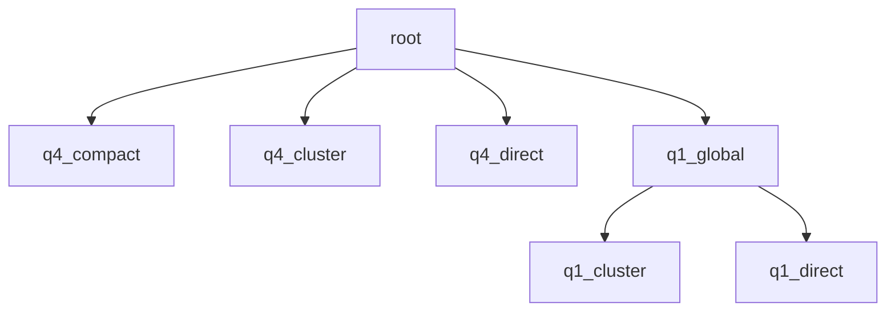

# fa4_decode schema

本任务以每请求 4 个 query token、KV 分段后全局合并的通用设计作为 root。它包含分段计算、FP32 部分结果和独立合并 kernel；其他节点改变合并协议、缩减到单 block，或调整 query 打包与 softmax 分工。完整 Contract 只在 `root.yaml` 中定义，包含 query 长度 1 和 4 的共同有效域。

| 节点 | Workload 与相对父节点的设计变化 |
| --- | --- |
| [root](root.yaml) | q4 的通用全局合并路径，每请求两个 query tile，分段结果由独立 kernel 合并 |
| [q4_compact](q4_compact.yaml) | q4 的特定长序列 batch；保留名义 split 布局，合并线程串行处理活跃 split 并跳过空负载 |
| [q4_cluster](q4_cluster.yaml) | q4 的较短 KV 等 workload；改为 cluster 内交换统计量、BF16 reduce-add，直接写回输出 |
| [q4_direct](q4_direct.yaml) | q4 的单 KV block；由单 CTA 完成各 query tile，省去 split workspace 与合并 |
| [q1_global](q1_global.yaml) | 每请求一个 query token；调整 query 打包，两个 softmax warpgroup 交替处理 block，保留全局合并 |
| [q1_cluster](q1_cluster.yaml) | q1 的 cluster workload；改为 cluster 内合并与直接写回 |
| [q1_direct](q1_direct.yaml) | q1 的单 KV block；单 CTA 直接完成归约与输出 |

树与各节点的 `meta_data.dispatch.parent` 对应，表示设计派生关系。root 和其他节点均按各自的 `when` 在共同契约域内参与选择；精确条件见 `meta_data.dispatch.when`，修订号见 `meta_data.version`，工作参数见 `design.work_schedule`。

q1/q4 表示每请求的 query token 数；global、cluster、direct、compact 概括合并方式。cluster 成员数、global split 数及循环长度的变化保留在所属节点内。
