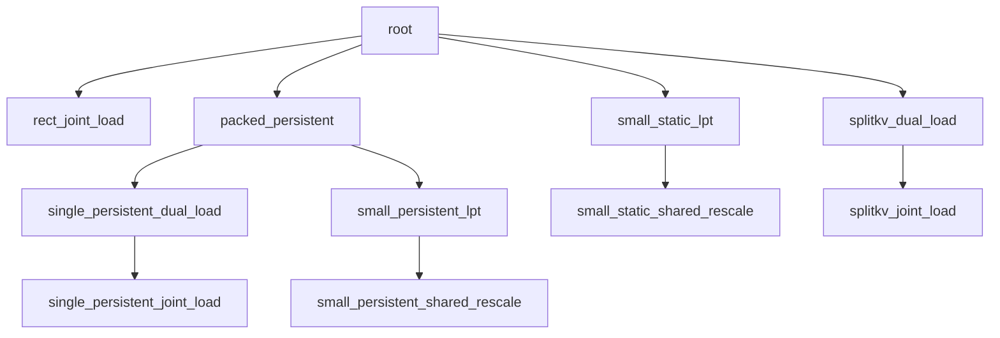

# FA4 prefill schema

本任务以矩形 static 调度、K/V 独立加载的设计作为 root。它保留通用的请求与 query 网格，其他节点针对工作量、请求组织或加载方式派生。完整 Contract 只在 `root.yaml` 中定义。

| 节点 | Workload 与相对父节点的设计变化 |
| --- | --- |
| [root](root.yaml) | 通用矩形 static 双加载设计，承接大 batch 及部分单请求 workload |
| [rect_joint_load](rect_joint_load.yaml) | 单请求；矩形调度下由同一加载角色处理 K/V |
| [packed_persistent](packed_persistent.yaml) | 中等 batch；折叠 query 工作并用 persistent worker 接续多份工作，保留请求次序 |
| [single_persistent_dual_load](single_persistent_dual_load.yaml) | 单请求；使用单请求的 persistent 工作映射 |
| [single_persistent_joint_load](single_persistent_joint_load.yaml) | 单请求；persistent 调度下由同一加载角色处理 K/V |
| [small_persistent_lpt](small_persistent_lpt.yaml) | 小 batch；persistent 遍历按 KV 长度降序排列请求 |
| [small_persistent_shared_rescale](small_persistent_shared_rescale.yaml) | 特定小 batch；softmax 向 correction 传递已计算的 alpha |
| [small_static_lpt](small_static_lpt.yaml) | 小 batch；按 KV 长度降序排列并折叠 query 工作，每个 worker 只承担一份工作 |
| [small_static_shared_rescale](small_static_shared_rescale.yaml) | 特定小 batch；static 调度下改为共享已计算的 alpha |
| [splitkv_dual_load](splitkv_dual_load.yaml) | query 工作不足时；增加 KV 分段、FP32 部分结果和独立合并 kernel |
| [splitkv_joint_load](splitkv_joint_load.yaml) | 单请求；保留 KV 分段与合并，由同一加载角色处理 K/V |

树与各节点的 `meta_data.dispatch.parent` 对应，表示设计派生关系。root 和其他节点均按各自的 `when` 在共同契约域内参与选择；精确条件与修订号分别见 YAML 的 `meta_data.dispatch.when`、`meta_data.version`。

LPT 指按 KV 长度降序排列请求；persistent 按固定步长接续多份工作，static 每个 worker 只承担一份工作。split 数、长度阈值等参数变化留在所属节点内。
