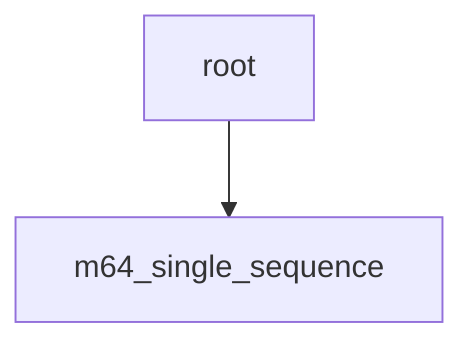

# gdn_prefill schema

本任务以支持打包多序列、逐序列更新加载边界的设计作为 root；单序列从中派生，使用固定边界和不同的标量预取流水线。完整 Contract 只在 `root.yaml` 中定义，覆盖单序列与多序列。

| 节点 | Workload 与相对父节点的设计变化 |
| --- | --- |
| [root](root.yaml) | 打包多序列；逐序列更新加载边界，标量处理与输出工作共用一个 warp |
| [m64_single_sequence](m64_single_sequence.yaml) | 单序列；固定加载边界，使用四个 chunk 的标量预取与对应缓冲协议 |

树与 `meta_data.dispatch.parent` 对应；两份设计按各自的 `meta_data.dispatch.when` 选择，共同使用 root 的 Contract。修订号见各节点的 `meta_data.version`。

m64 表示每个 CTA 处理 64 行 value/state。长度对齐与 zero/continuation 初态模式均留在所属节点内。
