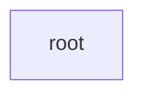

# qsa_prefill

本任务只有 root，保存完整 Contract 和核心设计：相邻 query 行共用索引并集，以 persistent 调度接续工作，并完成 attention 与 sigmoid gate。

唯一入口为 [root](root.yaml)。它省略 `dispatch`，节点 ID 缺省为 `root`，设计覆盖整个契约有效域。

该域为 NVIDIA L20D / SM103 上的 single-request fitted-step15，采用串行 eager 调用。具体输入、布局和有效域见 root 的 `contract`，修订号见 `meta_data.version`；`use_prefill_config` 的取值和 `out` 是否传入均沿用这一份设计。
